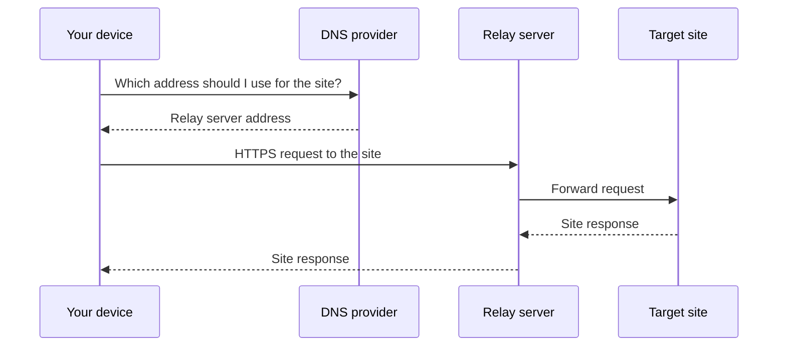

<p align="center">
  
</p>

<h1 align="center">SmartGate</h1>
<p align="center"><strong>Access selected sites through DNS.<br>Automatic address updates without a home server.</strong></p>
<p align="center">
  <a href="https://github.com/r4mdevelopment/SmartGate/actions/workflows/ci.yml"></a>
  
  
  <a href="LICENSE"></a>
</p>

[English](README.md) · [Русский](README.ru.md)

SmartGate helps you access selected sites through relay servers. Connect your device to your DNS profile, and SmartGate checks available servers and updates the addresses used to reach those sites. Checks run on GitHub, so you do not need to keep a computer switched on.

[Start setup](#quick-start) · [Documentation](docs/README.md) · [Troubleshooting](docs/en/operations/runbook.md)

<a name="contents"></a>

## 🧭 Contents

- [Features](#features)
- [Technology stack](#technology-stack)
- [Quick start](#quick-start)
- [Usage examples](#usage-examples)
- [How it works](#how-it-works)
- [Roadmap](#roadmap)
- [Contributing](#contributing)
- [License](#license)

<a name="features"></a>

## ✨ Features

| Feature | Benefit |
| --- | --- |
| Address checks | SmartGate checks servers and DNS answers; after a temporary failure, it rechecks the current address before replacing it |
| Scheduled updates | Once configured, addresses are checked every 6 hours |
| Server selection | Use GeoHide or your own compatible server on a VPS |
| Change control | Review the plan before applying it; limits protect against overly large changes |
| Recovery and rollback | A saved journal helps resolve interrupted updates and revert changes |
| Data protection | State and detailed reports stored in GitHub are encrypted |

**ChatGPT is enabled by default.** Claude, Gemini, Spotify, Notion, DeepL and Cursor have available presets that are disabled initially. Availability depends on the selected server and must be checked on your device. [How to add a service](docs/en/providers/services.md).

<a name="technology-stack"></a>

## 🛠️ Technology stack

| Component | Technologies |
| --- | --- |
| Controller | Python 3.12 / 3.13, HTTPX, dnspython |
| Execution and configuration | GitHub Actions, TOML |
| State protection | cryptography, AES-256-GCM |
| Quality checks | pytest, Ruff, mypy |

**Working MVP:** NextDNS + GeoHide; [checks and limitations](docs/en/project/acceptance.md). Custom relays are already supported; AdGuard Home and Technitium DNS adapters currently support reading only. [Provider selection](docs/en/providers/dns/README.md)

<a name="quick-start"></a>

## 🚀 Quick start

**You will need:** GitHub and NextDNS accounts, a separate empty DNS profile and your own encryption key. The controller runs in GitHub Actions. Decrypting detailed reports currently requires Python on a trusted device; see the [instructions](docs/en/operations/privacy.md#reading-a-detailed-report).

### 1. Create your own copy

Click **Fork → Copy the main branch only**, then open **Actions** and enable workflows. Complete the following steps in your fork.

### 2. Prepare configuration

In NextDNS, create a **separate profile without rewrites** and save its ID and your account's API key. In GitHub, open **Settings → Environments**, create an environment named **`smartgate`** and add:

| Type | Name | Value |
| --- | --- | --- |
| Secret | `SMARTGATE_DNS_PROFILE_ID` | ID of the new DNS profile |
| Secret | `SMARTGATE_DNS_API_KEY` | DNS-provider API key |
| Secret | `SMARTGATE_STATE_ENCRYPTION_KEY` | 32 random bytes in Base64; [how to prepare it](docs/en/operations/privacy.md#prepare-a-key) |
| Variable | `SMARTGATE_APPLY_ENABLED` | `false` |

Back up your encryption key. Keep your device's existing DNS settings until the checks are complete.

### 3. Review the plan

Open **Actions → SmartGate sync → Run workflow** on `main`: select **`command=preview`** and leave the other checkboxes unchecked. Preview creates neither DNS rules nor a state branch. Review Summary, then [decrypt the detailed report](docs/en/operations/privacy.md#reading-a-detailed-report) and check the domains and addresses.

If the initial plan exceeds the limit of 20 operations, temporarily increase `max_mutations` in [`config/smartgate.actions.toml`](config/smartgate.actions.toml) to the reviewed batch size and repeat preview. For example, **30** is sufficient for 25 new rules. [Full guide](docs/en/getting-started/quick-start.md)

### 4. Apply and confirm the result

After reviewing the plan, run **`command=sync`, `apply=true`, `bootstrap=true`**; leave `require_no_change` disabled. This is the first run against the empty profile. Wait for a successful result, then restore the limit to **20** if you increased it.

Next, run **`command=sync`, `apply=true`, `bootstrap=false`, `require_no_change=true`**. This run should successfully verify DNS with **zero changes**. If it fails, follow the [recovery instructions](docs/en/operations/runbook.md).

### 5. Connect your device

Follow your DNS profile's **Setup** page and [check ChatGPT](docs/en/getting-started/device-check.md). After successful checks, you can enable the schedule by setting `SMARTGATE_APPLY_ENABLED=true`.

**The first run requires account setup and waiting for Actions; the time depends on checks and GitHub's queue.** Step-by-step explanations are in the [first-run guide](docs/en/getting-started/quick-start.md).

<a name="usage-examples"></a>

## 💡 Usage examples

**Enable another service:** in [`config/services.toml`](config/services.toml), change `enabled = false` to `true` for the preset you need. Run preview, check limits and apply changes with `bootstrap=false`. Disabling a preset alone does not remove existing DNS rules. [Details](docs/en/providers/services.md)

<details>
<summary><strong>For developers: installation and a test plan without DNS writes</strong></summary>

Python 3.12 or 3.13, commands for Linux/macOS:

```bash
git clone https://github.com/r4mdevelopment/SmartGate.git
cd SmartGate
python3 -m venv .venv
source .venv/bin/activate
python -m pip install --require-hashes -r requirements-dev.lock
python -m pip install --no-deps --no-build-isolation -e .
python -m smartgate validate --config config/smartgate.example.toml
python -m smartgate preview --config config/smartgate.example.toml \
  --offline --fixtures tests/fixtures
```

This demonstration uses test data: it does not enable services or change DNS. [Windows and local development](docs/en/development/README.md)

</details>

<a name="how-it-works"></a>

## ⚙️ How it works

There are three roles: **DNS** tells your device which address to use, a **relay** server forwards requests to a site and its responses back, and **SmartGate** checks addresses and updates DNS configuration.

### Address updates


### When you open a site



SmartGate does not carry your device's traffic: it updates addresses. The DNS provider and relay server are selected independently. [Architecture](docs/en/architecture/architecture.md) · [Your own relay on a VPS](docs/en/operations/migration.md).

<details>
<summary><strong>Why is the smartgate-state branch needed?</strong></summary>

It retains information about created DNS rules and their change journal between runs. This lets SmartGate identify records it owns and determine what to do after an interrupted update. It is not a browsing history: its contents are encrypted and include no device query log.

This branch is required for GitHub Actions runs. Another store can be connected separately; local execution already supports a state file. Deleting the branch does not delete existing DNS rules and removes SmartGate's ownership information. [More about state](docs/en/operations/state.md).

</details>

<a name="roadmap"></a>

## 🗺️ Roadmap

- [x] Actions execution, route checks and DNS synchronization.
- [x] Custom relays through a manifest and an extensible service catalog.
- [x] Encrypted state and reports, recovery and rollback.
- [x] Step-by-step setup and GitHub Actions execution guide.
- [x] Clearer failure reasons in Summary without exposing domains or addresses.
- [x] Versioned release preparation, changelog and fork upgrade instructions.
- [x] First published versioned release: [v0.1.0](https://github.com/r4mdevelopment/SmartGate/releases/tag/v0.1.0).
- [x] English documentation by default and a separate Russian version.
- [x] Device access to Claude, Gemini, Spotify, Notion, DeepL and Cursor confirmed without geographic access errors.
- [x] [Safe encryption-key rotation](docs/en/operations/key-rotation.md) with a backup and verified state read-back.
- [x] [Backup recovery and state-upgrade drills](docs/en/operations/recovery-drills.md) on a separate test profile.
- [x] Service acceptance accepted by the user; no additional manual checks are planned.
- [x] [Optional short route monitoring](docs/en/operations/monitoring.md) with encrypted DNS/TLS/HTTP observations and no DNS writes.

- [x] [Optional emergency failover](docs/en/operations/failover.md): repeated mass-failure checks and up to 25 verified replacements.

[Changelog](CHANGELOG.md) · [Upgrade your fork](docs/en/operations/upgrading.md)

[Improvement priorities and MVP boundaries](docs/en/project/roadmap.md).

<a name="contributing"></a>

## 🤝 Contributing

Report problems through [Issues](https://github.com/r4mdevelopment/SmartGate/issues) and propose changes through Pull Requests. Include the version, reproduction steps and expected result; attach a run summary without keys or private data.

Before a PR, run the checks in the [developer guide](docs/en/development/README.md#checks). New DNS and relay integrations must preserve planning, record ownership and safeguards. [Developer documentation](docs/README.md)

The best way to support SmartGate is to give the repository a **Star** on GitHub. It helps other people discover the project.

<a name="license"></a>

## 📄 License

[MIT](LICENSE) © 2026 r4mdevelopment. External DNS and relay services are subject to their owners' terms.
