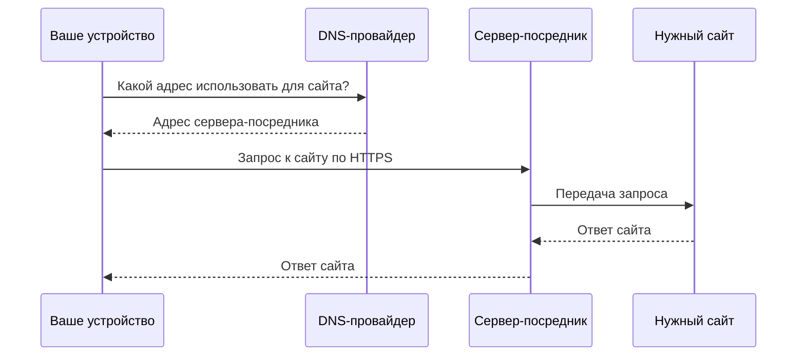

<p align="center">
  
</p>

<h1 align="center">SmartGate</h1>
<p align="center"><strong>Доступ к выбранным сайтам через DNS.<br>Автоматическое обновление адресов без домашнего сервера.</strong></p>
<p align="center">
  <a href="https://github.com/r4mdevelopment/SmartGate/actions/workflows/ci.yml"></a>
  
  
  <a href="LICENSE"></a>
</p>

[English](README.md) · [Русский](README.ru.md)

SmartGate помогает настроить доступ к выбранным сайтам через серверы-посредники. Вы подключаете устройство к своему DNS-профилю, а SmartGate проверяет доступные серверы и обновляет адреса, через которые открываются эти сайты. Проверки запускаются на GitHub — держать компьютер включённым не нужно.

[Начать настройку](#быстрый-старт) · [Документация](docs/ru/README.md) · [Помощь при сбое](docs/ru/operations/runbook.md)

<a name="содержание"></a>

## 🧭 Содержание

- [Возможности](#возможности)
- [Стек технологий](#стек-технологий)
- [Быстрый старт](#быстрый-старт)
- [Примеры использования](#примеры-использования)
- [Как это работает](#как-это-работает)
- [Планы развития](#планы-развития)
- [Как помочь проекту](#как-помочь-проекту)
- [Лицензия](#лицензия)

<a name="возможности"></a>

## ✨ Возможности

| Возможность | Что это даёт |
| --- | --- |
| Проверка адресов | SmartGate проверяет серверы и DNS-ответы; при временном сбое повторно проверяет текущий адрес перед заменой |
| Обновление по расписанию | После настройки адреса проверяются каждые 6 часов |
| Выбор серверов | Можно использовать GeoHide или свой совместимый сервер на VPS |
| Контроль изменений | Перед применением виден план; лимиты защищают от слишком больших изменений |
| Восстановление и откат | Сохранённый журнал помогает разобраться с прерванным обновлением и вернуть изменения |
| Защита данных | Состояние и подробные отчёты в GitHub зашифрованы |

**По умолчанию включён ChatGPT.** Для Claude, Gemini, Spotify, Notion, DeepL и Cursor есть готовые выключенные наборы. Доступность зависит от выбранного сервера и проверяется на устройстве. [Как добавить сервис](docs/ru/providers/services.md).

<a name="стек-технологий"></a>

## 🛠️ Стек технологий

| Компонент | Технологии |
| --- | --- |
| Контроллер | Python 3.12 / 3.13, HTTPX, dnspython |
| Запуск и настройки | GitHub Actions, TOML |
| Защита состояния | cryptography, AES-256-GCM |
| Проверки качества | pytest, Ruff, mypy |

**Рабочий MVP:** NextDNS + GeoHide; [проверки и ограничения](docs/ru/project/acceptance.md). Собственный relay уже поддерживается; DNS-адаптеры AdGuard Home и Technitium пока доступны только для чтения. [Выбор провайдеров](docs/ru/providers/dns/README.md)

<a name="быстрый-старт"></a>

## 🚀 Быстрый старт

**Понадобятся:** аккаунты GitHub и NextDNS, отдельный пустой DNS-профиль и собственный ключ шифрования. Контроллер работает в GitHub Actions. Для расшифровки подробных отчётов пока нужен Python на доверенном устройстве; [инструкция](docs/ru/operations/privacy.md#чтение-подробного-отчёта).

### 1. Создайте свою копию

Нажмите **Fork → Copy the main branch only**, затем откройте **Actions** и включите workflows. Следующие шаги выполняйте в своей копии.

### 2. Подготовьте настройки

В NextDNS создайте **отдельный профиль без rewrites**, сохраните его ID и API key аккаунта. В GitHub откройте **Settings → Environments**, создайте окружение **`smartgate`** и добавьте:

| Тип | Имя | Значение |
| --- | --- | --- |
| Secret | `SMARTGATE_DNS_PROFILE_ID` | ID нового DNS-профиля |
| Secret | `SMARTGATE_DNS_API_KEY` | API key DNS-провайдера |
| Secret | `SMARTGATE_STATE_ENCRYPTION_KEY` | 32 случайных байта в Base64; [как подготовить](docs/ru/operations/privacy.md#подготовьте-ключ) |
| Variable | `SMARTGATE_APPLY_ENABLED` | `false` |

Сохраните резервную копию ключа шифрования. До завершения проверок оставьте DNS устройства прежним.

### 3. Проверьте план

Откройте **Actions → SmartGate sync → Run workflow** на `main`: выберите **`command=preview`**, остальные флажки оставьте снятыми. Preview не создаёт DNS-правила или ветку состояния. Просмотрите Summary, затем [расшифруйте подробный отчёт](docs/ru/operations/privacy.md#чтение-подробного-отчёта) и проверьте домены и адреса.

Если первый план превышает лимит 20 операций, временно увеличьте `max_mutations` в [`config/smartgate.actions.toml`](config/smartgate.actions.toml) до проверенного размера партии и повторите preview. Например, для 25 новых правил достаточно **30**. [Полная инструкция](docs/ru/getting-started/quick-start.md)

### 4. Примените и подтвердите результат

После проверки плана запустите **`command=sync`, `apply=true`, `bootstrap=true`**; `require_no_change` оставьте выключенным. Это первый запуск на пустом профиле. Дождитесь успешного результата и верните лимит к **20**, если повышали его.

Затем выполните **`command=sync`, `apply=true`, `bootstrap=false`, `require_no_change=true`**. Этот запуск должен успешно проверить DNS с **нулём изменений**. При ошибке следуйте [инструкции восстановления](docs/ru/operations/runbook.md).

### 5. Подключите устройство

Следуйте странице **Setup** вашего DNS-профиля и [проверьте работу ChatGPT](docs/ru/getting-started/device-check.md). После успешных проверок можно включить расписание: установите `SMARTGATE_APPLY_ENABLED=true`.

**Первый запуск требует настройки аккаунтов и ожидания Actions; точное время зависит от проверок и очереди GitHub.** Пошаговые пояснения собраны в [руководстве первого запуска](docs/ru/getting-started/quick-start.md).

<a name="примеры-использования"></a>

## 💡 Примеры использования

**Включить другой сервис:** в [`config/services.toml`](config/services.toml) измените `enabled = false` на `true` для нужного набора. Выполните preview, проверьте лимиты и примените изменения с `bootstrap=false`. Отключение набора само по себе не удаляет действующие DNS-правила. [Подробнее](docs/ru/providers/services.md)

<details>
<summary><strong>Для разработчиков: установка и тестовый план без DNS-записей</strong></summary>

Python 3.12 или 3.13, команды для Linux/macOS:

```bash
git clone https://github.com/r4mdevelopment/SmartGate.git
cd SmartGate
python3 -m venv .venv
source .venv/bin/activate
python -m pip install --require-hashes -r requirements-dev.lock
python -m pip install --no-deps --no-build-isolation -e .
python -m smartgate validate --config config/smartgate.example.toml
python -m smartgate preview --config config/smartgate.example.toml \
  --offline --fixtures tests/fixtures
```

Это демонстрация на тестовых данных: она не включает сервисы и не меняет DNS. [Windows и локальная разработка](docs/ru/development/README.md)

</details>

<a name="как-это-работает"></a>

## ⚙️ Как это работает

Здесь три роли: **DNS** подсказывает устройству адрес, **relay** — сервер-посредник — передаёт запросы сайту и ответы обратно, а **SmartGate** проверяет адреса и обновляет настройки DNS.

### Обновление адресов


### Когда вы открываете сайт



SmartGate не передаёт трафик устройства: он отвечает за обновление адресов. DNS-провайдер и сервер-посредник выбираются независимо. [Архитектура](docs/ru/architecture/architecture.md) · [Свой relay на VPS](docs/ru/operations/migration.md).

<details>
<summary><strong>Зачем нужна ветка smartgate-state?</strong></summary>

Она сохраняет между запусками сведения о созданных DNS-правилах и журнал их изменений. Благодаря этому SmartGate понимает, какие записи ему принадлежат и что делать, если обновление прервалось. Это не история посещений: содержимое зашифровано и не содержит журнала запросов вашего устройства.

Для запуска через GitHub Actions эта ветка нужна. Другое хранилище можно подключить отдельно; локальный запуск уже поддерживает файл состояния. Удаление ветки не удаляет действующие DNS-правила и лишает SmartGate сведений об их владельце. [Подробнее о состоянии](docs/ru/operations/state.md).

</details>

<a name="планы-развития"></a>

## 🗺️ Планы развития

- [x] Запуск в Actions, проверка маршрутов и синхронизация DNS.
- [x] Собственный relay через manifest и расширяемый каталог сервисов.
- [x] Шифрование состояния и отчётов, recovery и rollback.
- [x] Пошаговое руководство настройки и запуска через GitHub Actions.
- [x] Более понятные причины сбоев в Summary без раскрытия доменов и адресов.
- [x] Подготовка версионных релизов, changelog и инструкция обновления своей копии.
- [x] Первый опубликованный версионный релиз: [v0.1.0](https://github.com/r4mdevelopment/SmartGate/releases/tag/v0.1.0).
- [x] Документация на английском по умолчанию и отдельная русская версия.

[Changelog](CHANGELOG.md) · [Обновление форка](docs/ru/operations/upgrading.md)

[Приоритеты доработок и границы MVP](docs/ru/project/roadmap.md).

<a name="как-помочь-проекту"></a>

## 🤝 Как помочь проекту

Сообщайте о проблемах через [Issues](https://github.com/r4mdevelopment/SmartGate/issues), предлагайте изменения через Pull Request. Укажите версию, шаги воспроизведения и ожидаемый результат; приложите сводку запуска без ключей и приватных данных.

Перед PR выполните проверки из [руководства разработчика](docs/ru/development/README.md#проверки). Новые DNS- и relay-интеграции должны сохранять планирование, владение записями и защитные проверки. [Документация для разработчиков](docs/ru/README.md)

Лучшая поддержка для SmartGate — поставить репозиторию **Star** на GitHub. Это помогает другим людям найти проект.

<a name="лицензия"></a>

## 📄 Лицензия

[MIT](LICENSE) © 2026 r4mdevelopment. Условия внешних DNS- и relay-сервисов определяются их владельцами.
