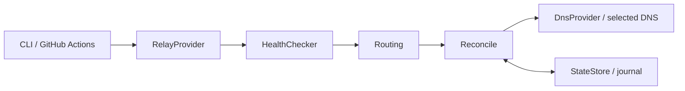

[SmartGate](../../../README.md) / [Documentation](../README.md) / SmartGate architecture

[English](architecture.md) · [Русский](../../ru/architecture/architecture.md)

# SmartGate architecture

SmartGate manages DNS rewrites for selected services. The controller runs on a schedule and does not carry application traffic.

## On this page

- [Components](#components)
- [Control and traffic flow](#control-and-traffic-flow)
- [Configuration](#configuration)
- [Relay providers](#relay-providers)
- [Route selection](#route-selection)
- [Safe synchronization](#safe-synchronization)
- [State and execution](#state-and-execution)
- [Current implementation](#current-implementation)

## Components

| Component | Responsibility |
| --- | --- |
| RelayProvider | Fetch published domain/IP pairs and source information |
| HealthChecker | Check a TLS connection to a candidate IP using the domain as SNI |
| Routing | Select a usable route according to the service policy |
| DnsProvider | Read and modify DNS rewrites |
| StateStore | Persist record ownership, routes, and the journal |
| Reconcile | Calculate the diff, check limits, and apply operations |
| CLI | Load configuration, connect the components, and produce a report |

The core uses immutable models and interfaces. Specific APIs, source URLs, and hosts formats remain in adapters.

## Control and traffic flow

Controller: GitHub Actions → SmartGate → relay source → checks and selection → DNS adapter API.

Client: a device asks the DNS provider for a domain, receives a relay IP, and connects to it. The relay forwards HTTPS traffic to the service. The controller does not require a server of your own.

## Configuration

The current configuration uses TOML with `schema_version = 2`. Schema 1 remains supported for compatibility with the previous NextDNS block; new installations use schema 2 and the shared `SMARTGATE_DNS_*` variables. The catalog lists enabled services, domain suffixes, required domains, exclusions, and provider order.

Validation rejects unknown keys, invalid types, duplicate provider IDs, and references to missing providers. DNS names are normalized to ASCII IDNA. Suffixes are compared at DNS label boundaries.

Loading configuration makes no network requests, saves no credentials, and writes no runtime state.

## Relay providers

The GeoHide adapter fetches complete regional hosts files directly from the [official RU/EU/US sources](../providers/relays.md#geohide), then filters domains for enabled services. Multiple IPs for one domain are retained as separate candidates. An address published for one domain cannot automatically be assigned to another.

The selfhosted adapter fetches a manifest for an already running SNI/TLS relay. The manifest declares supported domains and public endpoints. The VPS and relay are deployed separately.

## Route selection

Routing retains a verified current owned route between runs while the policy is unchanged. A provider policy change triggers a new selection. If no usable fallback is available, existing owned rewrites are retained with a degraded reason. New routes are selected from fresh sources by provider order, priority, and numeric IPv4. RTT does not affect selection. The rules are described in the [routing documentation](routing.md).

TLS is checked by connecting directly to a candidate IP with the service hostname and normal certificate verification. Success means TLS reachability from the observation point; application access and the egress region require separate acceptance checks.

## Safe synchronization

Implemented safeguards:

- The CLI requires explicit `--apply`. In Actions, manual writes require `apply=true`; scheduled writes additionally require `SMARTGATE_APPLY_ENABLED=true`. The initial Actions configuration permits a confirmed manual apply but does not enable automatic application.
- Only records with confirmed ownership are modified.
- Foreign records and manual drift block conflicting changes.
- An empty or corrupt source does not cause the profile to be cleared.
- A durable journal is saved before a mutation.
- An unknown mutation outcome requires read-back and recovery.
- Bulk changes are limited by the number and proportion of records being replaced.
- Parent rewrites and exclusions are checked according to the DNS provider's subtree semantics.

The selected DNS adapter's compatibility must be confirmed before enabling automatic synchronization, including API payloads and A/AAAA/HTTPS responses.

## State and execution

LocalStateStore uses atomic file replacement and locking. GitBranchStateStore stores data in an AES-256-GCM encrypted document on a separate branch with compare-and-swap; reading does not create a missing branch. The format and limitations are described in the [state documentation](../operations/state.md). Cache and artifacts must not be the sole source of ownership.

Periodic execution does not guarantee realtime failover: the delay depends on the schedule, runner, checks, API, and client DNS caches.

## Current implementation

The route selection core, GeoHide/selfhosted relay adapters, shared DNS contract, endpoint-bound DoH, neutral configuration, target-bound state, and explicit upgrade are implemented. The working DNS adapter has isolated live evidence; two self-hosted reference adapters have passed HTTP contract checks and remain read-only. Reconcile, recovery, rollback, the CLI, and workflows are covered by local checks. ChatGPT operation on a device, repeat synchronization without changes, state persistence between runners, and an actual scheduled run have been confirmed. This is a working MVP in the verified scenario, not a guarantee that every site or DNS server will work. Infrastructure and individual adapter readiness are described separately in [DNS providers](../providers/dns/README.md) and [acceptance](../project/acceptance.md).

---

[All documents](../README.md) · [Home](../../../README.md) · [Actions setup](../operations/actions.md) · [Troubleshooting](../operations/runbook.md)
