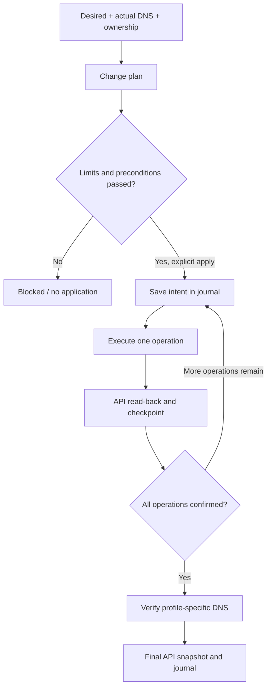

[SmartGate](../../../README.md) / [Documentation](../README.md) / Safe DNS synchronization

[English](reconcile.md) · [Русский](../../ru/architecture/reconcile.md)

# Safe DNS synchronization

Reconcile compares desired routes, actual rewrites, and saved ownership. It does not determine relay availability: that information comes from routing and TLS checks.

## On this page

- [Change plan](#change-plan)
- [Application](#application)
- [Errors and recovery](#errors-and-recovery)
- [Concurrent runs](#concurrent-runs)
- [Status](#status)

## Change plan

Build plan returns create, replace, and delete operations, as well as blocking reasons. The plan contains the original desired/removals, DNS digest, state revision, configuration policy, service catalog, and creation time.

| Situation | Decision |
| --- | --- |
| The owned ID, domain, and content match the desired value | No DNS operation |
| No record exists for the selected domain, and there are no conflicts | Create |
| The owned record matches the ledger, and the desired IPv4 has changed | Replace |
| The domain is explicitly removed, the record is owned, and allow_prune is enabled | Delete |
| The domain is absent from the source or desired, with no explicit removal | Retain |
| A foreign record exists on the domain, an ancestor, or a descendant | Blocked |
| The owned ID has disappeared or the value was changed manually | Blocked |

Publication is checked against the catalog and subtree acceptance. A parent rewrite cannot cover an excluded subdomain. Compatibility with the DNS provider's subtree semantics must be confirmed.

Default limits are 100 managed records, 20 operations per run, and a replace/delete proportion of up to 0.25 of existing managed records. The operator may explicitly raise the operation limit to 200 and the ratio to 1; the record limit remains 100. The schedule itself does not raise limits.

Bootstrap requires an empty profile and empty ownership. It exempts the run only from the ratio check; all other limits remain. Foreign records are not adopted.

## Application

Apply accepts a plan no older than 20 minutes and checks the current config digest, state revision, full DNS snapshot, and recalculated limits. A stale or modified preview cannot be applied.

Before the first mutation, the full plan, original DNS snapshot, before ownership, before selections, and target selections are persisted durably. Before each operation, an additional intent checkpoint is saved with compare-and-swap. A persistence error does not permit a DNS write.

Operations are executed sequentially. Before each call, current DNS and state preconditions are checked; afterward, the outcome is confirmed by reading the API again. The returned ID and ownership are saved before the next operation.

Success requires fresh A/AAAA/HTTPS/SVCB checks for all final managed records. The API snapshot is checked again after DNS verification. API drift, duplicates, and unconfirmed results do not yield applied.

A successful run without changes performs no DNS operations. A changed policy digest or provider metadata may be saved without a DNS mutation; the controller may also update source snapshots and probe cursors. `sync --apply --require-no-change` blocks a nonzero plan and pending recovery before writes, but permits these state updates after verifying a zero-change plan. For diagnostics without writing the ledger, use `doctor` without `--apply`.

## Errors and recovery

An unconfirmed mutation or lost checkpoint leaves a pending journal. Normal apply is blocked until recovery. Even an HTTP success response is no substitute for durable ownership and DNS verification.

Recovery rechecks the original plan and attributes the after state using the saved intent:

- exactly one matching domain/content record with a new ID may be confirmed;
- an ID from the original snapshot cannot be accepted as a new result;
- a known confirmed ID must match;
- ambiguity, manual drift, and a foreign subtree block changes.

If all operations have already been performed, recovery saves ownership and verifies DNS without repeating the mutation. If the before state remains or there is a gap between delete/create, the entire attempt is rolled back conservatively.

Rollback saves inverse intent before each reverse operation. It uses only a matching after state; foreign and modified IDs are not deleted. The restored before record may receive a new ID, which is saved in the ledger along with the previous provider and selection metadata. An interrupted rollback resumes from its own journal.

## Concurrent runs

The journal contains an execution run ID and deadline. Each new controller run must have a unique run ID. Another runner does not start recovery of an unfinished run until its execution lease expires.

Early recovery is permitted only after explicit confirmation that the previous process has stopped. Waiting for the lease to expire remains the safe default. CAS additionally protects every state write; Actions also needs a serial concurrency group.

This is not a shared transaction between GitHub and the DNS provider. Gaps remain between individual requests, and client DNS caches are not rolled back with rewrites.

## Status

Reconcile, apply, recovery, and rollback have been verified with offline end-to-end tests using fake DNS and a local durable store, including interruptions and CAS failures. This suite performs no real DNS changes. The command interface is described in [CLI](../operations/cli.md), and setup for manual execution and automatic application, which is disabled by default, is described in [Actions](../operations/actions.md). Separate live acceptance results and their limitations are described in the [acceptance matrix](../project/acceptance.md).

---

[All documents](../README.md) · [Home](../../../README.md) · [Actions setup](../operations/actions.md) · [Troubleshooting](../operations/runbook.md)
