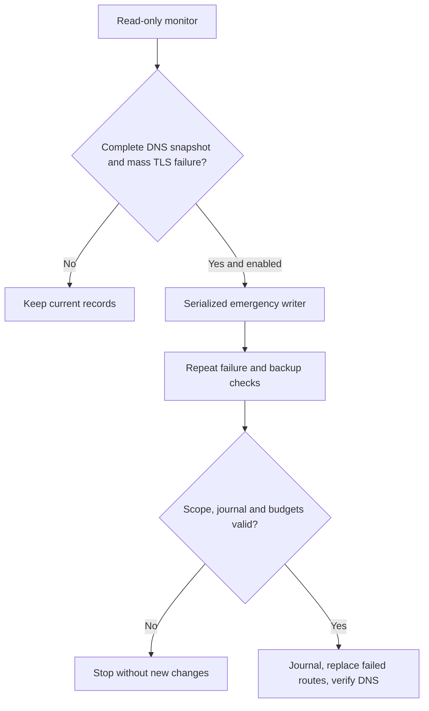

[SmartGate](../../../README.md) / [Documentation](../README.md) / Emergency failover

[English](failover.md) · [Русский](../../ru/operations/failover.md)

# Emergency failover

The optional 30-minute monitor can request a separate emergency check when many published routes stop accepting TLS connections. The writer independently confirms the failure, checks fresh alternatives and replaces only failed records. Healthy records keep their addresses. Ordinary six-hour sync and its limits are unchanged.

## Enable it

First complete normal setup, encrypted state and device checks. In your fork, configure these switches:

| Location | Variable | Value |
| --- | --- | --- |
| Repository Actions Variables | `SMARTGATE_MONITOR_ENABLED` | `true` |
| Repository Actions Variables | `SMARTGATE_FAILOVER_ENABLED` | `true` |
| `smartgate` Environment Variable | `SMARTGATE_APPLY_ENABLED` | `true` |

Use repository scope for the first two variables so the workflow can evaluate its job conditions. Use the existing DNS and encryption Secrets; no additional token is required. New forks leave emergency failover disabled.

For a read-only check, run **SmartGate sync → command=preview, emergency_only=true** on the default branch; leave all other checkboxes unchecked. A normal manual **SmartGate monitor** run never changes DNS. To explicitly allow that manual monitor to trigger its emergency writer, also check **emergency_apply**; the failover and Environment apply switches must be enabled. `SMARTGATE_MONITOR_ENABLED` is required only for scheduled monitoring. Explicit manual sync emergency apply does not require the monitor hint or automatic failover opt-in; it still repeats all controller checks and requires the Environment apply switch.

Set `SMARTGATE_FAILOVER_ENABLED=false` to prevent subsequent automatic emergency jobs. To pause automatic DNS publication by both workflows, also set the Environment's `SMARTGATE_APPLY_ENABLED=false`. An already running writer is not cancelled by changing these settings; inspect its result and journal before any further operation.

## Conditions and limits

All of these conditions must hold before emergency replacements:

1. The monitor has a complete, unchanged ownership snapshot and every checked A answer matches the saved record. At least **50%** of the owned routes, and **at least five**, have a timeout or connection error before a successful TLS handshake.
2. The separate writer verifies target binding, configuration, ownership, closed journal and current A/AAAA/HTTPS/SVCB semantics. It probes current routes again, waits five seconds and repeats the failed probes. The confirmed failures still meet the same threshold.
3. Fresh configured relay sources supply an alternative for **every confirmed failure**. Each selected alternative passes certificate-verified TLS twice. Cached/stale sources cannot supply emergency backups.
4. No more than **25** replacements are needed, the shared probe/API budgets permit the operation, and state/API preconditions still match. The durable journal is saved before the first DNS write.

With 25 owned routes, the threshold is **13** confirmed failures. Four owned routes cannot trigger this emergency mode. More than 25 confirmed failures stops the whole batch; it does not apply a partial subset just to meet the limit.

HTTP 403, Cloudflare challenges, application errors and certificate errors do not trigger automatic replacement. DNS mismatches, incomplete observations, policy drift, a pending journal or missing backups stop the emergency operation. A TLS success establishes the connection and certificate; it cannot prove browser login, streaming or file access.

The emergency plan contains only replacements for failed owned routes. It does not add domains, delete unrelated rules, enable services, bootstrap a profile or perform journal recovery. The temporary cap of 25 and replacement ratio of 100% apply only to this restricted plan; ordinary `max_mutations=20`, `max_change_ratio=0.25` and pruning settings remain unchanged. A DNS adapter may internally implement a logical replacement as deleting the old rule and creating its replacement.

## Execution and reports

The reader has `contents: read`; only the gated writer has `contents: write` for encrypted state checkpoints. Emergency writes share the normal sync's concurrency group and never cancel an in-progress update. Both jobs use `deployment: false`, so they do not create Deployment entries. The ordinary sync still reports its own Deployment result.

Summary contains aggregate failure counts. Addresses, domains and detailed checks are in the encrypted artifact, retained for seven days. An emergency `no_change` means no eligible mass failure remained; it does not certify that every website works. `applied` requires confirmed API results and DNS verification. `blocked`, `partial` and failed DNS verification remain visible as failures; inspect the encrypted details and [recovery instructions](runbook.md). Emergency jobs do not recover a pending journal: use the existing recovery command or the ordinary sync's recovery path before another change.

## Timing and costs

The 30-minute schedule is not immediate failover. GitHub may delay jobs; DNS caches may retain the previous address after an update. A problem visible only on a user's network may not be visible from the runner. Healthy routes are kept, so SmartGate does not rotate back merely because an earlier server returns.

An extra writer job runs only after the eligible monitor hint and opt-in gates. It can run for up to 25 minutes, with a 20-minute controller deadline, and makes additional API, DNS and TLS requests. Check private-repository Actions usage and your provider limits. See [monitoring costs](monitoring.md#frequency-and-cost).
