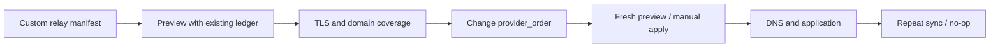

[SmartGate](../../../README.md) / [Documentation](../README.md) / Changing relay providers

[English](migration.md) · [Русский](../../ru/operations/migration.md)

# Changing relay providers

The DNS provider, profile and ownership ledger remain the same. A custom relay connects through a manifest; routing and the DNS adapter require no changes. Server deployment is outside this procedure.


## On this page

- [Preparing a self-hosted relay](#preparing-a-self-hosted-relay)
- [Checking and switching](#checking-and-switching)
- [Migration limits](#migration-limits)
- [Switching back](#switching-back)
- [Verified behavior](#verified-behavior)
- [Moving to provider-neutral DNS configuration](#moving-to-provider-neutral-dns-configuration)



## Preparing a self-hosted relay

The relay must accept TCP/TLS on public port 443, support the required SNI and pass through the service certificate without replacing it. Its upstream DNS must not use the same rewrite profile. Do not enable an open proxy: server access and route restrictions are configured separately.

Create a manifest based on `config/selfhosted.example.json`. The example address `203.0.113.10` is a documentation placeholder: the validator rejects it. Replace it with your relay's actual public IP and list the supported domains. Supporting only `chatgpt.com` does not confirm resource loading, authentication or files.

Add the provider to TOML:

```toml
[[relay.providers]]
id = "own"
type = "selfhosted"
manifest_path = "own-relay.json"
```

In the service catalog, initially keep GeoHide first and add `own` as a fallback. All `provider_order` identifiers must exist in the configuration. The manifest contains no API keys or credentials.

## Checking and switching

1. Exclude parallel writers and automatic apply during the migration. Run `validate`, then live `preview` using the same state store as the current profile.
2. Check TLS/SNI for owned and required domains, the source, observation time and change count. A GitHub runner check does not replace a device check.
3. Move `own` to the first position in `provider_order` and repeat preview.
4. Apply the fresh plan manually through `sync --apply`, without `--bootstrap`.
5. Check profile DNS responses, the application and a repeat sync. Only then remove GeoHide from the configuration.

If the IP does not change, no DNS mutation is needed: provider metadata and the policy digest are updated. An IP change should produce a replace with a new owned ID. The old IP is not removed merely because a source is missing; without a confirmed replacement, the current route is retained with degraded status.

## Migration limits

Defaults allow 20 operations and replace/delete of no more than 25% of managed records. A full migration may exceed these limits. After reviewing the specific plan, the operator explicitly sets sufficient `max_mutations` and `max_change_ratio` for the manual migration. Maximums are 200 operations, a ratio of 1 and 100 managed records. Restore normal limits after verification. GitBranchStateStore additionally checks the GitHub budget in advance: an oversized batch is blocked even if max_mutations permits it; see [storage limits](state.md).

Changing limits does not authorize work on foreign records or bypass CAS, the journal, subtree checks or fresh DNS verification. The automatic schedule does not raise limits itself.

## Switching back

Restore the original provider order, run preview and manual sync. Rolling back the latest journal is allowed only if after IDs/values match: see the [runbook](runbook.md). If there is drift, do not delete records manually to bypass the block. Do not use a second independent ledger.

## Verified behavior

A contract test compares curated GeoHide hosts with an equivalent self-hosted manifest. An integration test switches GeoHide → manifest → GeoHide through real relay adapters using fixture HTTP, retaining the DNS interface and owned ID when the IP is unchanged. This proves the migration contract; an actual VPS and its application availability have not been verified separately.

## Moving to provider-neutral DNS configuration

The new configuration schema does not transfer ownership automatically. First stop writers and check the old ledger, API records and new target. Then run read-only `state-upgrade`, save a backup and authorize an explicit state upgrade. After read-back, run a new preview; normal sync is allowed only after reviewing the fresh plan.

For an existing GitHub schedule, coordinate the transition of Secrets, main and the ledger: the previous workflow must stop writing before upgrade. Retain old variables and a compatible configuration until verification is complete. Restoring automatic apply is a separate operating step. For plaintext Git state, schema upgrade must be followed by a separate [encryption transition](privacy.md); the ordinary live Git runtime does not read plaintext.

---

[All documentation](../README.md) · [Home](../../../README.md) · [Actions setup](actions.md) · [Troubleshooting](runbook.md)
