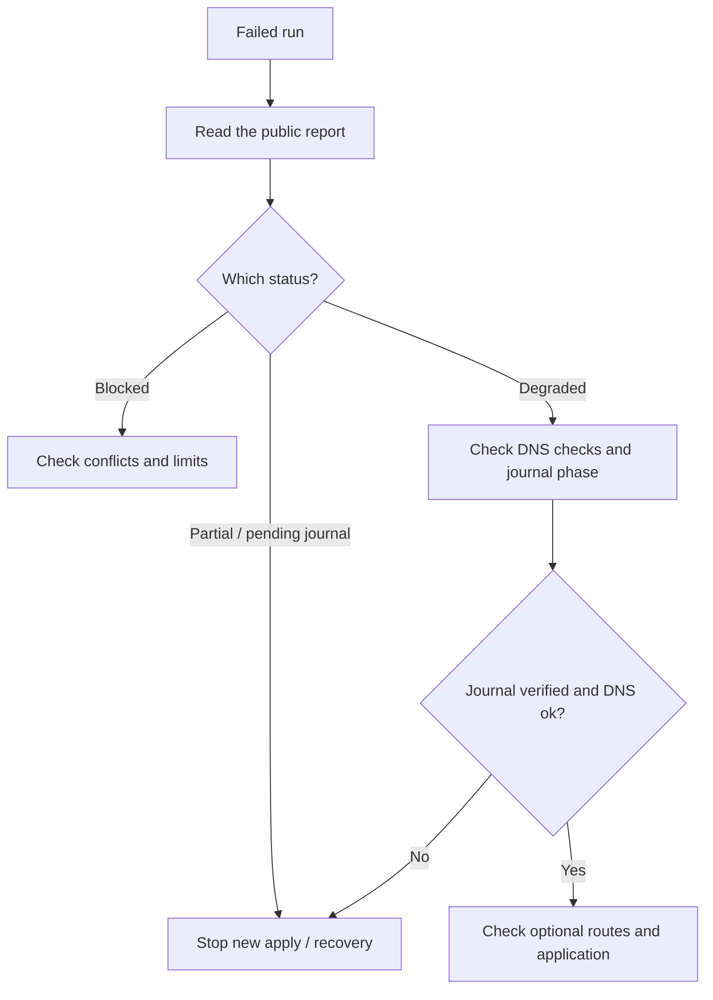

[SmartGate](../../../README.md) / [Documentation](../README.md) / Handling synchronization failures

[English](runbook.md) · [Русский](../../ru/operations/runbook.md)

# Handling synchronization failures

In Summary, first read the **What happened** table: reason code, explanation and next step. The [reason reference](diagnostics.md) helps you choose an action without decrypting every detail. If the cause is unknown or you need the specific plan, use the encrypted report.

Start diagnosis with `preview` or `doctor` without `--apply`. Parameters are described in [CLI](cli.md); workflow setup is in [Actions](actions.md). Do not manually edit ownership or the journal to bypass a block.


## On this page

- [Blocked](#blocked)
- [Pending journal or partial](#pending-journal-or-partial)
- [Degraded after apply](#degraded-after-apply)
- [Drift or ambiguity during recovery](#drift-or-ambiguity-during-recovery)
- [Interrupted rollback](#interrupted-rollback)
- [Local lock](#local-lock)
- [Recovery commands](#recovery-commands)
- [Readiness checks and migration](#readiness-checks-and-migration)
- [Availability below 85%](#availability-below-85)
- [Key or encryption error](#key-or-encryption-error)



## Blocked

When the current relay has a temporary network failure, SmartGate automatically performs [one delayed TLS check](../architecture/health.md#rechecking-a-transient-failure) in the same run. An address that recovers is retained; a successful sync with confirmed DNS responses may end green without a manual rerun. If the failure outlasts the check or the overall probe budget is exhausted, the result remains a failure. The next scheduled run checks routes again.

A bulk replacement exceeding `max_mutations` or `max_change_ratio` cannot be considered a successful deployment: it is blocked before apply. Do not raise limits just to obtain a green status.

Check the reasons in the plan: a foreign rewrite, a manually changed owned record, failed subtree compatibility, exceeded limits or changed configuration.

Rebuild preview against current DNS and state. Raising limits must be a deliberate operator decision after reviewing the specific changes. Foreign records are not deleted to resolve conflicts automatically.

### Verification sync stopped by protection

`No-change acceptance blocked` means the fresh plan contains DNS operations. In `require_no_change=true` mode, this is an expected block before writes: check the operation count in Summary, download and decrypt the detailed artifact, review the plan itself and decide whether the changes are needed. A zero-operation preview before the run does not bypass this check.

If protection detects a pending journal, diagnose it and perform separately authorized recovery. Verification mode does not launch recovery itself. With a zero-operation plan, DNS remains the same; state observations may be updated.

## Pending journal or partial

Stop new apply operations. Saved state and the actual profile must first be reconciled through recovery. Manually creating the same domain again may make attribution ambiguous.

If the previous process is still running, wait for it to finish. By default, recovery by another runner waits until the execution deadline expires. Early takeover is allowed only after confirming that the previous process has stopped.

If the state store is unavailable, do not continue DNS operations or use a new independent ledger. Wait for storage to recover, load its current revision and perform recovery.

## Degraded after apply

> [!IMPORTANT]
> `degraded` describes several situations. An unavailable optional domain with `verified` and successful DNS checks is not equivalent to an unfinished operation. Check the journal phase and report checks before recovery.

If profile DNS is not confirmed after an API write:

The API may have confirmed records while DNS responses still differ from the expected values. State remains partial; ordinary apply is blocked. Recovery repeats DNS checks and confirms the journal without duplicating completed operations.

Check the profile DoH endpoint and observation location. Successful DNS verification does not mean successful application access through the relay.

## Drift or ambiguity during recovery

Do not automatically delete discovered records. Compare record IDs and before/after values against the durable journal, then determine which changes the operator made.

An after copy with a different ID, or multiple records matching domain/content, requires manual investigation. Rollback is also blocked if a known after record was manually changed or deleted. A record appearing before its operation has started is not considered a controller result, even if its domain/content matches the plan. Deleting the entire profile is not a valid workaround.

## Interrupted rollback

Recover the saved inverse intent after the lease expires or after confirming that the previous process has stopped. If before has already been restored and its new ID can be attributed unambiguously, it does not need to be created again.

After recovery, check final ownership and profile DNS responses. Client caches and open connections may continue using the previous IP.

## Local lock

A state lock may remain after a crash. Delete it only after confirming that the process using the file has stopped. Do not delete the state file itself or create a parallel ledger for the same profile.


## Recovery commands

```console
python -m smartgate recover --config config/smartgate.toml --report-dir .smartgate/reports
python -m smartgate recover --config config/smartgate.toml --apply --report-dir .smartgate/reports
python -m smartgate rollback --config config/smartgate.toml --run-id SAVED_JOURNAL_RUN_ID --apply --report-dir .smartgate/reports
```

The first call only shows the saved attempt. Apply requires `sync.enabled=true`. Replace `SAVED_JOURNAL_RUN_ID` with `journal_run_id` from the latest report; old journals outside current state are not rolled back automatically.

Another runner waits for the 20-minute execution lease to expire. Only after checking that the previous process has stopped may you explicitly add `--previous-run-stopped` to recover/rollback with apply. Do not use this flag to recover in parallel with a running controller.

If Actions manages the profile, use the same `config/smartgate.actions.toml` and GitBranchStateStore with DNS variables, `GITHUB_REPOSITORY`/`GITHUB_TOKEN`, the state key and encrypted report binding parameters from the [CLI example](cli.md#first-apply); independent local state is prohibited. In Actions, select recover or rollback and `apply=true`; for rollback, provide the saved ID. Recovery does not need bootstrap.

## Readiness checks and migration

Before enabling the schedule, run the [test-device scenarios](../getting-started/device-check.md). The current verification status is in the [acceptance matrix](../project/acceptance.md). To change relay providers, follow the [migration procedure](migration.md) with preview and manual apply.


### Availability below 85%

Download and [decrypt the detailed artifact](privacy.md#reading-a-detailed-report), then check its availability: the threshold applies separately to each enabled service, and all required domains must work. Failed IP candidates do not themselves reduce the percentage if the domain receives another confirmed route. With a verified journal and successful DNS checks, low coverage requires checking the relay/domain set rather than repeating recovery. See [counting rules](actions.md#route-availability-threshold).

## Key or encryption error

Do not delete state or bootstrap again. Stop writers and check the Secret, repository/branch/instance binding, closed journal and backup. If the migration response is lost, determine the exact current commit first. If the key is lost, restore the previous key from a protected copy; a new key will not read old state. See [privacy and recovery](privacy.md).

---

[All documentation](../README.md) · [Home](../../../README.md) · [Actions setup](actions.md) · [Troubleshooting](runbook.md)
