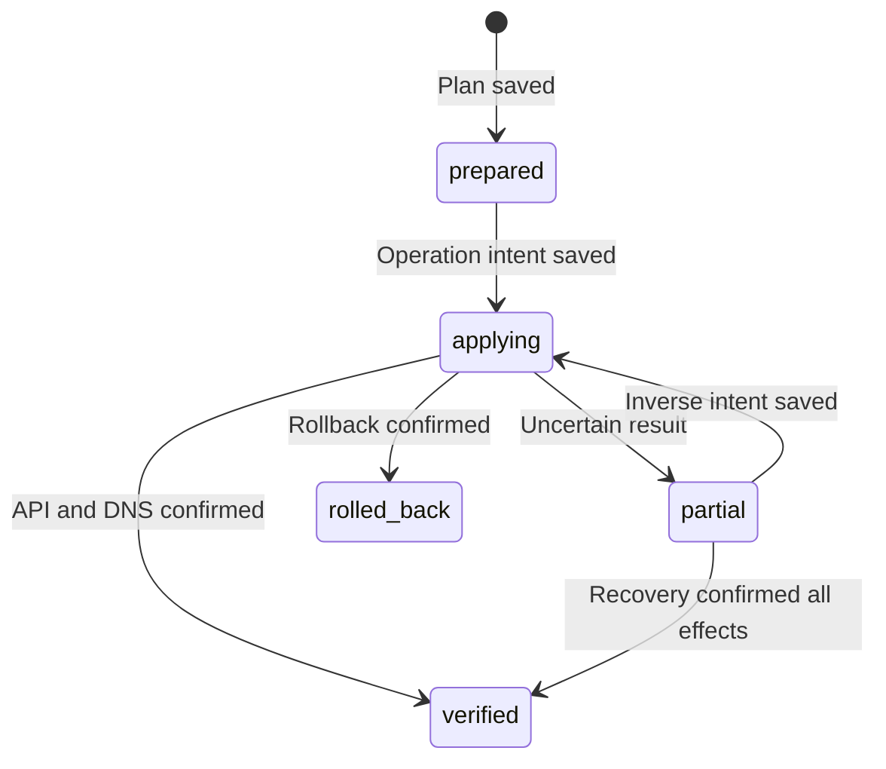

[SmartGate](../../../README.md) / [Documentation](../README.md) / State and operation journal

[English](state.md) · [Русский](../../ru/operations/state.md)

# State and operation journal

StateStore stores DNS record ownership, selected routes, source snapshots, probe cursors and the operation journal. State is bound to a specific DNS target. DNS credentials, the GitHub token and the encryption key are not part of the document. The journal describes controller operations rather than the user's website visits.

## On this page

- [Format](#format)
- [Local storage](#local-storage)
- [GitHub storage](#github-storage)
- [Journal](#journal)
- [Using the contract](#using-the-contract)
- [Complete apply journal](#complete-apply-journal)
- [Binding to the DNS target](#binding-to-the-dns-target)
- [Upgrading old state](#upgrading-old-state)
- [Git state encryption](#git-state-encryption)

## Format

The current document uses `schema_version = 2`; schema 1 is read for an explicitly authorized transition. Unknown fields, duplicate JSON keys, incompatible versions, a different profile, incorrect types and timestamps without a timezone block loading. The maximum JSON document size before encryption is 1 MiB.

Ownership contains the record ID, domain, current IPv4, provider ID and last check time. Selections retain the endpoint and routing policy digest. The selection cache alone does not confirm ownership.

Storage returns the revision: for a file, it is the content's SHA-256; for GitHub, the state branch commit SHA. In JSON, revision is stored as null to avoid making the hash depend on itself.

## Local storage

LocalStateStore stores unencrypted JSON; the file and backups must remain outside Git with restricted access. The adapter writes a temporary file in the same directory, flushes it to disk and atomically replaces the main file. On POSIX, it also synchronizes the directory. A file lock prevents concurrent access through this adapter.

On save, the actual revision is compared with the expected revision. A mismatch means StateConflict. A write error blocks further work; it must not be treated as a successful journal save.

A `state.json.lock` file may remain after a crash. It is not automatically deleted based on age. Before deleting it manually, confirm that the process using the file has stopped.

## GitHub storage

GitBranchStateStore uses a separate `smartgate-state` branch and a `state/{instance_id}.json` file. Reads are pinned to a specific commit SHA. Saving creates a blob, tree and commit with the expected parent, then updates the ref without force.

The current branch is checked again before the update. A concurrent change or server refusal blocks the save. A unique marker for each commit intent prevents two identical saves from producing the same commit. Ref update rules are described in the [GitHub REST API](https://docs.github.com/en/rest/git/refs).

Reading a missing branch returns missing state and does not create it. Bootstrap is a separate explicit operation: it creates an orphan branch containing only state data, without source code. Saving another profile to an existing branch preserves other files through the base tree.

The GitHub token is sent only to `api.github.com`; redirects and system proxy settings are disabled. Each transport instance allows up to 400 requests and 20 minutes. An uncertain write result is not retried automatically: reread state first.

Before apply/recover/rollback, the controller checks the request budget for the entire batch: `13 × operation count + 35 + remaining reread reserve` (the reserve starts at 12). If the remaining budget is insufficient, DNS changes do not start. This is separate from `max_mutations`; raising the mutation limit does not increase the GitHub limit.

Within one run, the adapter caches author identity and the latest state/tree only by exact commit SHA. It rereads the current branch ref; the cache does not permit saving over another writer's changes. A new runner starts without this cache.

If GitHub returns the exact previous commit SHA immediately after a confirmed `save`, the adapter retries only the ref read: at most 4 attempts per read and 12 additional requests per store instance. Ref requests have a unique parameter and `Cache-Control: no-cache`. These additional requests are reserved during preflight within the overall limit of 400. The adapter waits for the confirmed new version rather than substituting it from the cache. An unrelated version, missing ref, malformed response or exhausted retries does not count as successfully reading the expected state. Commit creation and ref updates are not resent.

The token's account determines the author and committer of state commits. For a GitHub Actions installation token, the personal repository owner is used. A GitHub noreply email links the commit to the account without publishing a personal email address. Organization repositories require separate authorship support.

Branch restrictions and protection may prohibit writes; such an error does not authorize further DNS operations. Actions caches and artifacts are not used as sources of ownership.

## Journal

`prepare_journal` saves the plan, initial snapshot and pending intent. The apply executor must pass the complete actual DNS snapshot through `before_snapshot` and durably save the returned state before the first mutation. Without this optional argument, the helper retains only before records for affected operations.

`record_operation` returns new state with the operation result; the caller must save it. Confirmed create/replace requires a record ID and domain/content matching the intent. Confirmed delete has no new record.

| Phase | Meaning |
| --- | --- |
| prepared | Intent prepared |
| applying | Intermediate results received |
| verified | All operations confirmed |
| partial | Unconfirmed results remain; recovery required |
| rolled_back | All operations marked as restored |

Pending, unknown or failed prevents verified status. A new intent cannot be prepared over an unfinished journal. Helper functions neither perform DNS operations nor save the file themselves.

Operation execution, reconciliation of unknown results and rollback are implemented in [reconcile](../architecture/reconcile.md). The journal detects an unfinished run; it does not make GitHub and the DNS provider a single transaction.

## Using the contract

After `save(state, expected_revision)`, the caller receives a new revision. Before the next save, update immutable state with this revision or reload it. Do not use independent local and GitHub ledgers for the same active profile.

GitHub adapter behavior is covered by offline contract tests. State saving and reading by the next GitHub runner were confirmed in manual integration acceptance checks; see the [acceptance matrix](../project/acceptance.md).

## Complete apply journal

The reconcile executor supplements the journal with before ownership/selections, target selections, original desired/removals, safety policy and the service catalog. For rollback, its flag and pending inverse intent are saved; the execution run ID/deadline protects against recovery of an active process.

Added journal fields have explicit compatible defaults when reading old documents; unknown fields are still rejected. An old journal lacking sufficient safety/ownership metadata may be read, but automatic execution is blocked. This does not authorize bypassing preconditions through manual editing.

## Binding to the DNS target

State schema 2 stores `target_id` and a fingerprint of the provider type, API origin, scope and DoH. The same target passes through the plan, journal, apply and recovery. A server or profile with the same instance name does not gain ownership of previous records. Git state is stored in `state/<instance_id>.json`; the identifier accepts only a safe short name.

## Upgrading old state

`state-upgrade --config <config>` checks the transition without writing. Adding `--apply` updates only the state format, without creating, deleting or replacing DNS records. The command requires the new configuration for the current NextDNS target, matching owned IDs on API read-back and a closed journal. An unfinished journal must first be recovered using the previous configuration.

In Git, the new file and removal of the old path are included in one commit after checking the previous head. The previous commit retains the original ledger. A lost ref update response is confirmed by reading the exact new commit and both paths; the mutation is not repeated. Another writer blocks the transition.

Local storage upgrades the explicitly selected file under an exclusive lock, saves the original to an adjacent `.backup`, atomically replaces the file and reads it back. The backup and state must remain outside Git. Changing the DNS provider requires a new empty target and separate acceptance checks, rather than upgrading the old ledger.

## Git state encryption

Live Git storage saves the entire document in an AES-256-GCM envelope. The JSON document and reconcile interfaces do not change; a fresh nonce is issued on every save. AAD binds data to the repository, state branch and instance ID. The maximum decrypted document size remains 1 MiB. A key, integrity, version or binding error blocks operation without fallback to empty state. The local file adapter remains unencrypted.

`state-encrypt` is a separate transition for plaintext schema 2 already bound to its target, distinct from `state-upgrade`. It preserves ownership, plan ID and closed journal ID, checks the DNS API and verifies the exact commit after CAS. If the result is unknown, the write is not repeated. See [key, transition and publication limits](privacy.md).

---

[All documentation](../README.md) · [Home](../../../README.md) · [Actions setup](actions.md) · [Troubleshooting](runbook.md)
