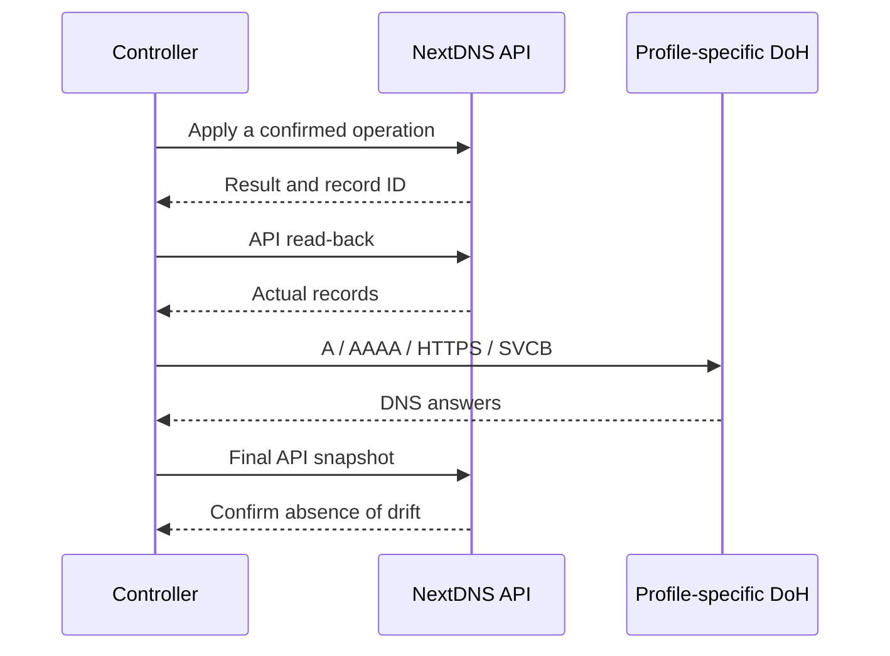

[SmartGate](../../../../README.md) / [Documentation](../../README.md) / NextDNS adapter and DNS verification

[English](nextdns.md) · [Русский](../../../ru/providers/dns/nextdns.md)

# NextDNS adapter and DNS verification

NextDnsProvider manages only rewrites in the selected profile. It does not change device settings, the profile as a whole or other NextDNS settings.

## On this page

- [API operations](#api-operations)
- [Transport limits](#transport-limits)
- [Profile-specific DoH](#profile-specific-doh)
- [Compatibility checks](#compatibility-checks)

## API operations

List reads all pages and returns record ID, domain and content. Foreign IPv6 or hostname rewrites remain in the read result: they must not be lost when calculating changes. A malformed response or duplicate ID blocks operation.

Create sends name/content for a public IPv4 address, validates the returned ID and A type, then confirms the record with another list. A response without a confirmed ID or with mismatched read-back is not a successful write.

Delete first compares the actual record with the supplied precondition. If the record has drifted or is missing, no DELETE request is sent. After deletion, the absence of the exact ID is verified.

Replace uses the verified DELETE → POST strategy, retaining the domain. It is not atomic: the rewrite may be absent between requests. An unknown delete outcome or creation failure after deletion returns RecoveryRequired with before/after context. A mutation with an unknown outcome is not retried automatically. An explicit HTTP 429 may trigger a bounded retry according to Retry-After; this is a separate rate-limit response case.

The adapter does not decide ownership. Before using create/delete/replace, the [reconcile](../../architecture/reconcile.md) layer verifies ownership, conflicts and limits, and durably saves the journal.

## Transport limits

The API key is sent only to api.nextdns.io. Redirects and system proxy settings are disabled. Requests are spaced at least two seconds apart: up to 30 requests per minute, with a maximum of 400 calls and 20 minutes per transport instance.

GET uses bounded retries for network failures and 5xx responses. HTTP 429 uses bounded Retry-After. HTTP 401/403 and an errors envelope block the request. A lost mutation response, 5xx after a mutation or unconfirmed read-back requires recovery.

Error details do not include the key, raw response body or HTTP headers. RecoveryRequired context is intended for the local journal and recovery; public reports must account for the sensitivity of runtime IDs.

## Profile-specific DoH

The adapter supplies the shared DnsVerifier with `https://dns.nextdns.io/{profile_id}`, using DNS wire messages. The API key is not sent in these requests.

For each desired domain, it checks:

| Type | Expected answer |
| --- | --- |
| A | Exactly the selected IPv4 address |
| AAAA | Empty answer |
| HTTPS | Empty answer |
| SVCB | Empty answer |

The MVP conservatively rejects nonempty alternative AAAA/HTTPS/SVCB answers: a client using them could bypass the IPv4 rewrite. Allowing them requires a separate compatibility analysis.

The response must match the query ID, question, owner name and record type. SERVFAIL, NXDOMAIN, truncated responses, unexpected CNAMEs and malformed wire payloads do not confirm the route. Only NOERROR with the expected values produces ok.

The verifier observes DNS propagation for up to 60 seconds per verify call. Confirmed questions are not repeated; remaining questions are checked at intervals of up to five seconds. A late response is not accepted as confirmation; no new questions are sent after the deadline. Limits are 800 DoH requests and 20 minutes per instance, and up to 100 unique domains per call.

Verify returns a DnsCheck for every question, including actual answers, expectations, timing and ok. The caller must check every result; the absence of an exception alone does not mean DNS verification succeeded.

## Compatibility checks

A separate compatibility harness verifies the basic API/DNS contract. The production adapter additionally runs the opt-in test `tests/live/test_nextdns_production.py` against a separate, initially empty profile.

The production roundtrip checks create/list/delete/replace, parent/child precedence and A/AAAA/HTTPS/SVCB. Intent is saved before a write; cleanup removes only exact test matches. Ambiguous and foreign records are retained for manual review. The runtime journal and evidence stay outside Git; public fixtures are anonymized.

These checks confirm API behavior and answers from the test profile. They do not confirm application access through a relay from a client's network.

---

[All documentation](../../README.md) · [Home](../../../../README.md) · [Actions setup](../../operations/actions.md) · [Troubleshooting](../../operations/runbook.md)

## Connection setup

Example: [nextdns.example.toml](../../../../config/dns/nextdns.example.toml). Schema 2 uses the shared DNS block, the `api_key` authentication method, and the `SMARTGATE_DNS_API_KEY` and `SMARTGATE_DNS_PROFILE_ID` variables. This adapter needs a profile identifier; other adapters do not. The API origin is fixed, and the DoH address is derived from the same profile.

For migration from schema 1, legacy variable names are temporarily accepted. If old and new names are both set with different values, the run is blocked without exposing their values. Custom variable names are permitted in configuration and do not receive automatic aliases.

Changing the example does not migrate an existing schedule or ownership state to the new schema: migration is performed separately after checking the target and state.

## First run in GitHub

Create a separate empty NextDNS profile. The API key is available on the [account page](https://my.nextdns.io/account); get the profile ID from the selected profile's settings. In the `smartgate` Environment, save the key as `SMARTGATE_DNS_API_KEY` and the profile ID as `SMARTGATE_DNS_PROFILE_ID`, leaving `SMARTGATE_APPLY_ENABLED` set to `false`.

For a new installation, follow [Actions setup](../../operations/actions.md): preview, explicit empty bootstrap, another sync and a [device check](../../getting-started/device-check.md). An existing legacy ledger must not be initialized again: it requires a verified state-upgrade. The operation limit is checked against a fresh preview and is not waived by bootstrap.

## Quotas

NextDNS counts profile DNS requests, including the controller's checks. Under the terms checked on 7 October 2026, the free plan included 300,000 requests per month; above that limit, NextDNS continued to answer as ordinary DNS without configured features. Check usage and current terms on the [NextDNS pricing page](https://nextdns.io/pricing); rewrite functionality after quota exhaustion is not assumed here.

The API transport is limited to 30 requests per minute, 400 calls and 20 minutes per transport instance; these are SmartGate limits, not claimed NextDNS API quotas.
