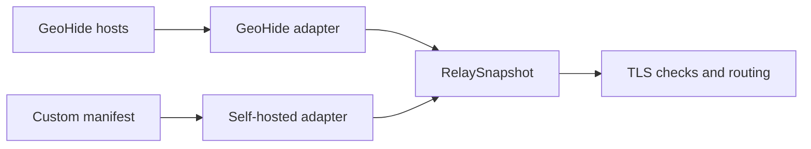

[SmartGate](../../../README.md) / [Documentation](../README.md) / Relay providers

[English](relays.md) · [Русский](../../ru/providers/relays.md)

# Relay providers

GeoHide and the selfhosted provider return the same RelaySnapshot: explicit domain/IP pairs, fetch time, source digest and warnings. The DNS layer does not depend on the source format. An address for one domain is never automatically reused for another.

## On this page

- [GeoHide](#geohide)
- [Selfhosted manifest](#selfhosted-manifest)
- [Snapshot quality](#snapshot-quality)
- [Verified sources](#verified-sources)



## GeoHide

The region selects a complete hosts list directly from the [official GeoHide website](https://geohide.ru/hosts):

| Region | Source |
| --- | --- |
| RU | [hosts RU](https://dns.geohide.ru:8443/static/formats/ru/hosts.txt) |
| EU | [hosts EU](https://dns.geohide.ru:8443/static/formats/eu/hosts.txt) |
| US | [hosts US](https://dns.geohide.ru:8443/static/formats/us/hosts.txt) |

The website's `?v=…` link parameter is not pinned: SmartGate fetches the current file at its stable URL. It does not use a mirror in a third-party GitHub repository. The complete list is downloaded, but routing selects only domains belonging to enabled services in `config/services.toml`. Other sites are not enabled automatically.

Fetching uses a separate HTTP client without DNS-provider credentials. Redirects are prohibited and TLS is verified. Up to three GET attempts are allowed; the connect/read timeout is 10 seconds. The decompressed source is limited to 5 MiB, including responses without Content-Length.

The parser supports BOM, CRLF, comments and multiple aliases per line. Unique pairs are retained in deterministic order. Public IPv6 addresses remain in the snapshot for analysis; the IPv4 MVP does not publish them as DesiredRewrite. Blocking, private, loopback, multicast and reserved IPs do not become relay candidates.

The region labels the source list; it does not prove the exit country. Sources may contain addresses of third-party services. Candidates are treated as endpoints published by the source until TLS checks confirm their suitability.

## Selfhosted manifest

A local JSON file contains schema_version=1, provider_id and endpoints. Each endpoint explicitly specifies a public ip, port=443, transport=tls_sni_tcp and a nonempty domains list. Unknown fields, a different transport/port or a mismatched provider_id are rejected.

Example structure: [selfhosted.example.json](../../../config/selfhosted.example.json). The documentation IP in the example is deliberately unsuitable for connections: replace it with the public IP of an already running relay. A VPS IP alone, without a configured SNI/TLS relay, does not provide access to a service.

Add a provider in TOML:

```toml
[[relay.providers]]
id = "own"
type = "selfhosted"
manifest_path = "selfhosted.json"
```

Then explicitly add own to the selected service's provider_order. This changes the source configuration, not the DNS adapter contract. Switching requires a fresh preview and an explicit sync --apply with the existing ownership ledger; see the [migration guide](../operations/migration.md) for the sequence.

## Snapshot quality

After fetching, the source is filtered by the service catalog. An empty result, a missing required domain, more than 5% malformed hosts lines or a drop of more than 50% in selected pairs blocks the source. The drop is also checked per service, so growth in another service cannot hide lost routes.

validate_snapshot compares the snapshot with the previous successful snapshot. A run passes a single captured now to fetch and validate_snapshot. A snapshot from an earlier run retains its fetched_at; up to 24 hours old, it is marked as suitable only for retaining existing routes. Older than 24 hours, it is rejected. Source failure is not a reason to delete DNS records.

## Verified sources

On 9 October 2026, the existing parser successfully read the official RU/EU/US files: 1020 domains in each list, with 4034, 5036 and 4034 valid domain/IP pairs respectively. These counts describe that particular check and change with the source. Fetching hosts does not change DNS rules and does not by itself confirm service availability.

The minimal curated fixture contains only published RU pairs for chatgpt.com. A contract test builds an equivalent selfhosted manifest and compares domain/ip/port/transport without provider provenance.

Only ChatGPT is enabled by default in the catalog, with the suffixes chatgpt.com, openai.com, oaistatic.com and oaiusercontent.com. Other presets are disabled and enter selection only after the service is explicitly enabled. This does not prove that auth/CDN domains are complete for login, file uploads and all clients. Parent NextDNS rewrites extend to subdomains; consent to that scope is configured separately through allow_subtree_rewrites.

The TLS/SNI checker is implemented and has been tested against two chatgpt.com candidates; see [health checks](../architecture/health.md). Manual ChatGPT acceptance on Android and a laptop is confirmed within the scope stated in [acceptance checks](../project/acceptance.md). A custom VPS relay has only been verified with contract fixtures, without live acceptance. Successfully reading hosts does not confirm that ChatGPT works.

---

[All documentation](../README.md) · [Home](../../../README.md) · [Actions setup](../operations/actions.md) · [Troubleshooting](../operations/runbook.md)
