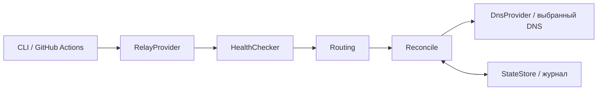

[SmartGate](../../../README.ru.md) / [Документация](../README.md) / Архитектура SmartGate

[English](../../en/architecture/architecture.md) · [Русский](architecture.md)

# Архитектура SmartGate

SmartGate управляет DNS rewrites для выбранных сервисов. Контроллер запускается по расписанию и не передаёт прикладной трафик.

## На этой странице

- [Компоненты](#компоненты)
- [Управление и передача трафика](#управление-и-передача-трафика)
- [Конфигурация](#конфигурация)
- [Провайдеры relay](#провайдеры-relay)
- [Выбор маршрута](#выбор-маршрута)
- [Безопасная синхронизация](#безопасная-синхронизация)
- [Состояние и выполнение](#состояние-и-выполнение)
- [Текущая реализация](#текущая-реализация)

## Компоненты

| Компонент | Ответственность |
| --- | --- |
| RelayProvider | Получить опубликованные пары домен/IP и сведения об источнике |
| HealthChecker | Проверить TLS-соединение с IP кандидата и SNI домена |
| Routing | Выбрать пригодный маршрут по политике сервиса |
| DnsProvider | Прочитать и изменить DNS rewrites |
| StateStore | Сохранить владение записями, маршруты и журнал |
| Reconcile | Рассчитать diff, проверить ограничения и применить операции |
| CLI | Загрузить конфигурацию, связать компоненты и сформировать отчёт |

Ядро работает с immutable моделями и интерфейсами. Конкретные API, URLs источников и форматы hosts остаются в адаптерах.

## Управление и передача трафика

Контроллер: GitHub Actions → SmartGate → relay source → проверка и выбор → DNS adapter API.

Клиент: устройство запрашивает домен у DNS-провайдера, получает IP relay и соединяется с ним. Relay передаёт HTTPS-трафик сервису. Собственный сервер для контроллера не требуется.

## Конфигурация

Текущая конфигурация — TOML со `schema_version = 2`. Schema 1 поддерживается для совместимости с прежним NextDNS-блоком; новые установки используют schema 2 и общие переменные `SMARTGATE_DNS_*`. Каталог перечисляет включённые сервисы, доменные суффиксы, обязательные домены, исключения и порядок провайдеров.

Валидация отклоняет неизвестные ключи, неверные типы, повторяющиеся provider IDs и ссылки на отсутствующих провайдеров. DNS-имена нормализуются в ASCII IDNA. Суффиксы сравниваются по границам DNS-меток.

Загрузка конфигурации не выполняет сетевые запросы, не сохраняет credentials и не пишет runtime state.

## Провайдеры relay

GeoHide-адаптер получает полные региональные hosts непосредственно с [официальных RU/EU/US источников](../providers/relays.md#geohide), затем отбирает домены включённых сервисов. Несколько IP одного домена сохраняются как отдельные кандидаты. Адрес, опубликованный для одного домена, нельзя автоматически назначить другому.

Selfhosted-адаптер получает manifest уже работающего SNI/TLS relay. Manifest объявляет поддерживаемые домены и публичные endpoints. Сам VPS и relay разворачиваются отдельно.

## Выбор маршрута

Routing сохраняет проверенный текущий owned маршрут между запусками при неизменённой политике. Изменение политики провайдеров инициирует новый выбор. При отсутствии пригодного резерва существующие owned rewrites сохраняются с degraded-причиной. Новые маршруты выбираются из свежих источников по порядку провайдеров, priority и числовому IPv4. RTT не влияет на выбор. Правила описаны в [документации маршрутизации](routing.md).

TLS проверяется прямым подключением к IP кандидата с hostname сервиса и обычной проверкой сертификата. Успех означает TLS-доступность с точки наблюдения; прикладной доступ и регион выхода требуют отдельной приёмки.

## Безопасная синхронизация

Реализованные защитные условия:

- CLI требует явный `--apply`. В Actions ручная запись требует `apply=true`; запись по расписанию отдельно требует `SMARTGATE_APPLY_ENABLED=true`. Начальная Actions-конфигурация разрешает подтверждённый ручной apply, но не включает автоприменение.
- Изменяются только записи с подтверждённым ownership.
- Чужие записи и ручной drift блокируют конфликтующие изменения.
- Пустой или повреждённый источник не приводит к очистке профиля.
- Перед mutation сохраняется durable journal.
- Неизвестный результат mutation требует read-back и recovery.
- Массовые изменения ограничены количеством и долей заменяемых записей.
- Parent rewrites и исключения проверяются с учётом subtree-семантики DNS-провайдера.

Совместимость выбранного DNS-адаптера необходимо подтвердить до включения автоматической синхронизации, включая API payloads и ответы A/AAAA/HTTPS.

## Состояние и выполнение

LocalStateStore использует атомарную замену файла и блокировку. GitBranchStateStore хранит данные в зашифрованном AES-256-GCM документе отдельной ветки с compare-and-swap; чтение не создаёт отсутствующую ветку. Формат и ограничения описаны в [документации состояния](../operations/state.md). Cache и artifacts не должны быть единственным источником ownership.

Периодический запуск не гарантирует realtime failover: задержка зависит от расписания, runner, проверок, API и клиентских DNS-кешей.

## Текущая реализация

Реализованы ядро выбора маршрутов, relay-адаптеры GeoHide/selfhosted, общий DNS-контракт, endpoint-bound DoH, нейтральная конфигурация, target-bound состояние и explicit upgrade. Рабочий DNS-адаптер имеет изолированную live evidence; два self-hosted reference-адаптера прошли HTTP-контракты и остаются read-only. Reconcile, recovery, rollback, CLI и workflows покрыты локальными проверками. Подтверждены работа ChatGPT на устройстве, повторная синхронизация без изменений, сохранение состояния между runners и настоящий запуск по расписанию. Это рабочий MVP в проверенном сценарии, а не гарантия работы всех сайтов или всех DNS-серверов. Готовность инфраструктуры и каждого адаптера описана отдельно в [DNS-провайдерах](../providers/dns/README.md) и [приёмке](../project/acceptance.md).

---

[Все документы](../README.md) · [Главная](../../../README.ru.md) · [Настройка Actions](../operations/actions.md) · [Помощь при сбое](../operations/runbook.md)
