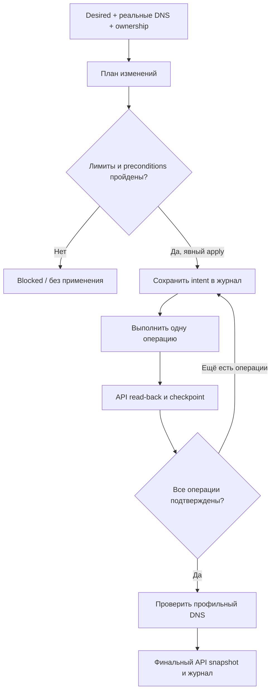

[SmartGate](../../../README.ru.md) / [Документация](../README.md) / Безопасная синхронизация DNS

[English](../../en/architecture/reconcile.md) · [Русский](reconcile.md)

# Безопасная синхронизация DNS

Reconcile сравнивает желаемые маршруты, фактические rewrites и сохранённое ownership. Он не определяет доступность relay: эти сведения поступают из routing и TLS-проверок.

## На этой странице

- [План изменений](#план-изменений)
- [Применение](#применение)
- [Ошибки и восстановление](#ошибки-и-восстановление)
- [Конкурентные запуски](#конкурентные-запуски)
- [Статус](#статус)

## План изменений

Build plan возвращает create, replace и delete, а также причины блокировки. План содержит исходные desired/removals, digest DNS, revision состояния, конфигурационную политику, каталог сервисов и время создания.

| Ситуация | Решение |
| --- | --- |
| Owned ID, домен и content совпадают с желаемым значением | Нет DNS-операции |
| Нет записи для выбранного домена, конфликтов нет | Create |
| Owned запись соответствует ledger, желаемый IPv4 изменился | Replace |
| Домен явно удалён, запись owned и allow_prune включён | Delete |
| Домен отсутствует в источнике или desired, явного removal нет | Сохранить |
| Чужая запись на домене, предке или потомке | Blocked |
| Owned ID исчез или значение изменено вручную | Blocked |

Публикация проверяется по каталогу и subtree acceptance. Parent rewrite не может покрывать исключённый поддомен. Совместимость subtree-семантики DNS-провайдера должна быть подтверждена.

По умолчанию действуют пределы: 100 managed records, 20 операций за запуск и доля replace/delete до 0.25 от существующих managed records. Оператор может явно изменить предел операций до 200 и ratio до 1; предел записей остаётся 100. Само расписание лимиты не повышает.

Bootstrap требует пустого профиля и пустого ownership. Он освобождает только от проверки ratio, остальные ограничения сохраняются. Чужие записи не принимаются во владение.

## Применение

Apply принимает план не старше 20 минут и проверяет текущий config digest, state revision, полный DNS snapshot и повторно рассчитанные ограничения. Изменившийся или модифицированный preview нельзя применить.

Перед первой mutation долговременно сохраняются полный план, исходный DNS snapshot, before ownership, before selections и target selections. Перед каждой операцией выполняется дополнительный intent checkpoint с compare-and-swap. Ошибка сохранения не разрешает DNS-запись.

Операции выполняются последовательно. Before каждого вызова проверяются актуальные DNS и state preconditions; after подтверждается повторным чтением API. Полученный ID и ownership сохраняются до следующей операции.

Успех требует свежих A/AAAA/HTTPS/SVCB checks для всех итоговых managed записей. После DNS-верификации ещё раз проверяется API snapshot. API drift, дубли и неподтверждённые результаты не дают applied.

При успешном запуске без изменений DNS-операции не выполняются. Изменившийся digest политики или provider metadata может быть сохранён без DNS mutation; контроллер также может обновить снимки источников и курсоры проверок. Режим `sync --apply --require-no-change` блокирует ненулевой план и pending recovery до записей, но разрешает такие обновления состояния после проверки нулевого плана. Для диагностики без записи ledger используйте `doctor` без `--apply`.

## Ошибки и восстановление

Неподтверждённая mutation либо потерянный checkpoint оставляют pending journal. Обычный apply блокируется до recovery. Даже полученный HTTP success не заменяет durable ownership и DNS-проверку.

Recovery повторно проверяет исходный план и атрибутирует after по сохранённому intent:

- ровно одна matching domain/content запись с новым ID может быть подтверждена;
- ID из исходного snapshot нельзя принять за новый результат;
- известный confirmed ID должен совпадать;
- неоднозначность, ручной drift и чужой subtree блокируют изменения.

Если все операции уже фактически выполнены, recovery сохраняет ownership и проверяет DNS без повторной mutation. Если остаётся before или разрыв между delete/create, выполняется консервативный rollback всей попытки.

Rollback сохраняет inverse intent перед каждой обратной операцией. Он использует только совпадающий after; чужие и изменённые ID не удаляются. Восстановленный before может получить новый ID, который записывается в ledger вместе с прежними provider и selection metadata. Прерывание rollback возобновляется по его собственному журналу.

## Конкурентные запуски

Журнал содержит execution run ID и deadline. Каждый новый запуск контроллера должен иметь уникальный run ID. Другой runner не начинает recovery незавершённого запуска до окончания его execution lease.

Досрочное восстановление допускается только после явного подтверждения, что прежний процесс остановлен. Ожидание окончания lease остаётся безопасным вариантом по умолчанию. CAS дополнительно защищает каждую запись состояния; для Actions также нужен последовательный concurrency group.

Это не общая транзакция GitHub и DNS-провайдера. Между отдельными запросами остаются интервалы, а DNS-кеши клиента не откатываются вместе с rewrites.

## Статус

Reconcile, apply, recovery и rollback проверены offline end-to-end тестами с fake DNS и локальным durable store, включая прерывания и CAS failures. Этот набор не выполняет реальных DNS-изменений. Командный интерфейс описан в [CLI](../operations/cli.md), настройка ручного запуска и выключенного по умолчанию автоматического применения — в [Actions](../operations/actions.md). Результаты отдельной live-приёмки и её пределы описаны в [матрице приёмки](../project/acceptance.md).

---

[Все документы](../README.md) · [Главная](../../../README.ru.md) · [Настройка Actions](../operations/actions.md) · [Помощь при сбое](../operations/runbook.md)
