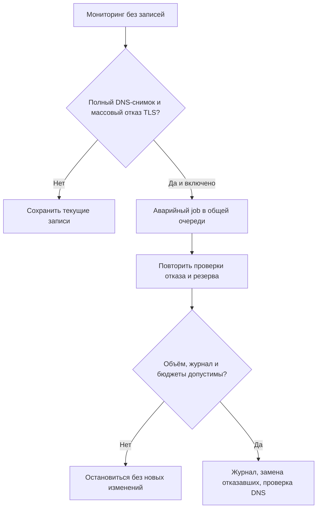

[SmartGate](../../../README.ru.md) / [Документация](../README.md) / Аварийное переключение

[English](../../en/operations/failover.md) · [Русский](failover.md)

# Аварийное переключение

Необязательный мониторинг раз в 30 минут может запросить отдельную аварийную проверку, когда многие опубликованные маршруты перестают устанавливать TLS-соединение. Отдельный job заново подтверждает отказ, проверяет свежий резерв и заменяет только отказавшие записи. Исправные адреса сохраняются. Обычный sync раз в шесть часов и его лимиты не меняются.

## Включение

Сначала завершите обычную настройку, шифрование состояния и проверку на устройстве. В своём форке настройте:

| Где | Переменная | Значение |
| --- | --- | --- |
| Actions Variables репозитория | `SMARTGATE_MONITOR_ENABLED` | `true` |
| Actions Variables репозитория | `SMARTGATE_FAILOVER_ENABLED` | `true` |
| Variable Environment `smartgate` | `SMARTGATE_APPLY_ENABLED` | `true` |

Первые две переменные нужны именно на уровне репозитория: они используются в условиях запуска jobs. Используются существующие DNS Secrets и ключ шифрования; дополнительный токен не нужен. В новых форках аварийное переключение выключено.

Для проверки без записей запустите **SmartGate sync → command=preview, emergency_only=true** на основной ветке; остальные флажки оставьте выключенными. Обычный ручной запуск **SmartGate monitor** DNS не меняет. Чтобы явно разрешить этому ручному мониторингу аварийное применение, включите **emergency_apply**; нужны failover на уровне репозитория и apply в Environment. `SMARTGATE_MONITOR_ENABLED` нужен только для расписания. Явный ручной sync с аварийным apply не требует сигнала мониторинга или автоматического failover-флажка, но повторяет все проверки контроллера и требует apply в Environment.

`SMARTGATE_FAILOVER_ENABLED=false` предотвращает следующие автоматические аварийные jobs. Чтобы остановить автоматические DNS-записи обоих workflows, также установите `SMARTGATE_APPLY_ENABLED=false` в Environment. Уже работающий job сменой переменной не отменяется: перед следующими действиями проверьте его результат и журнал.

## Условия и ограничения

Перед заменой должны выполняться все условия:

1. У мониторинга полное неизменившееся состояние владения, а все проверенные A-ответы совпадают с сохранёнными записями. Минимум **50%** управляемых маршрутов и **не менее пяти** имеют таймаут или ошибку соединения до успешного TLS-handshake.
2. Отдельный job проверяет привязку DNS-профиля, конфигурацию, владение, завершённый журнал и текущие A/AAAA/HTTPS/SVCB-ответы. Заново проверяет текущие адреса, ждёт пять секунд и повторяет проверки отказавших. Подтверждённый отказ по-прежнему достигает того же порога.
3. Свежие источники relay дают альтернативу **для каждого подтверждённого отказа**. Каждый выбранный резерв дважды проходит TLS с проверкой сертификата. Кешированные и устаревшие источники для аварийного резерва не используются.
4. Нужно не более **25** замен, общие бюджеты проверок и API допускают операцию, состояние и API по-прежнему совпадают. До первой DNS-записи сохраняется устойчивый журнал.

Для 25 управляемых маршрутов порог — **13** подтверждённых отказов. Четыре маршрута аварийный режим не запускают. Если подтверждённых отказов больше 25, вся операция останавливается; частичная порция ради обхода лимита не применяется.

HTTP 403, Cloudflare challenge, ошибки приложения и сертификата не вызывают автоматическую замену. Неверные DNS-ответы, неполные наблюдения, изменение политики, незавершённый журнал и отсутствие резерва останавливают аварийную операцию. Успешный TLS подтверждает соединение и сертификат, но не вход, streaming или файлы в браузере.

Аварийный план заменяет только отказавшие управляемые маршруты. Он не добавляет домены, не удаляет чужие правила, не включает сервисы, не делает bootstrap и не восстанавливает журнал. Временный предел 25 и доля замен 100% относятся только к этому ограниченному плану; обычные `max_mutations=20`, `max_change_ratio=0.25` и настройки удаления остаются прежними. Внутри DNS-адаптера логическая замена может состоять из удаления старого правила и создания его замены.

## Выполнение и отчёты

У читающего job `contents: read`; только отдельно разрешённый job имеет `contents: write` для зашифрованных checkpoints. Запись использует ту же concurrency group, что обычный sync, и не отменяет выполняющееся обновление. Оба jobs используют `deployment: false` и не создают Deployment. Обычный sync по-прежнему показывает свой результат в Deployments.

В Summary только количество отказов. Адреса, домены и подробные проверки находятся в зашифрованном artifact со сроком хранения семь дней. Аварийный `no_change` означает отсутствие подходящего массового отказа, а не исправность всех сайтов. Для `applied` нужны подтверждённый API и проверка DNS. `blocked`, `partial` и неуспешная DNS-проверка остаются видимыми ошибками: смотрите зашифрованные подробности и [инструкцию восстановления](runbook.md). Аварийный job pending-журнал не восстанавливает: перед новым изменением нужен существующий recovery или восстановление через обычный sync.

## Время и стоимость

Расписание раз в 30 минут не обеспечивает мгновенного переключения. GitHub может задержать запуск; DNS-кеш может удерживать прежний адрес после обновления. Проблема только в сети пользователя может быть не видна runner. Исправный текущий адрес сохраняется: возврат старого сервера сам по себе не вызывает обратную ротацию.

Дополнительный job запускается только после подходящего сигнала мониторинга и прохождения флажков включения. Его timeout — 25 минут, deadline контроллера — 20 минут. Он делает дополнительные API-, DNS- и TLS-запросы. Следите за Actions usage приватного репозитория и лимитами провайдеров. [Стоимость мониторинга](monitoring.md#частота-и-расход-ресурсов).
