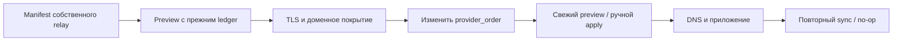

[SmartGate](../../../README.ru.md) / [Документация](../README.md) / Смена relay-провайдера

[English](../../en/operations/migration.md) · [Русский](migration.md)

# Смена relay-провайдера

DNS-провайдер, профиль и ownership ledger остаются прежними. Собственный relay подключается через manifest; routing и DNS-адаптер не требуют изменений. Развёртывание сервера не входит в эту процедуру.


## На этой странице

- [Подготовка self-hosted relay](#подготовка-self-hosted-relay)
- [Проверка и переключение](#проверка-и-переключение)
- [Пределы миграции](#пределы-миграции)
- [Возврат](#возврат)
- [Проверенное поведение](#проверенное-поведение)
- [Переход на нейтральную DNS-конфигурацию](#переход-на-нейтральную-dns-конфигурацию)



## Подготовка self-hosted relay

Relay должен принимать TCP/TLS на публичном 443, поддерживать нужный SNI и передавать сертификат сервиса без подмены. Его upstream DNS не должен попадать в тот же rewrite-профиль. Не включайте открытый proxy: ограничения доступа и маршрутов на сервере настраиваются отдельно.

Создайте manifest по `config/selfhosted.example.json`. Адрес `203.0.113.10` в примере — документационный placeholder: валидатор его отвергнет. Замените его реальным публичным IP собственного relay и перечислите поддерживаемые домены. Поддержка только `chatgpt.com` не подтверждает загрузку ресурсов, авторизацию и файлы.

Добавьте провайдера в TOML:

```toml
[[relay.providers]]
id = "own"
type = "selfhosted"
manifest_path = "own-relay.json"
```

В каталоге сервисов сначала оставьте GeoHide первым, а `own` добавьте резервом. Все идентификаторы `provider_order` должны присутствовать в конфигурации. Manifest не содержит API keys или credentials.

## Проверка и переключение

1. На время переноса исключите параллельные writers и автоматическое применение. Выполните `validate`, затем live `preview` с тем же state store, которым пользуется текущий профиль.
2. Проверьте TLS/SNI для owned и required доменов, источник, время наблюдения и количество изменений. Проверка с GitHub runner не заменяет проверку устройства.
3. Переместите `own` на первое место `provider_order` и снова выполните preview.
4. Примените свежий план вручную через `sync --apply` без `--bootstrap`.
5. Проверьте профильные DNS-ответы, приложение и повторный sync. Только после этого исключайте GeoHide из конфигурации.

Если IP не меняется, DNS mutation не нужна: обновляются provider metadata и digest политики. При смене IP ожидается replace с новым owned ID. Старый IP не удаляется из-за отсутствия источника; при отсутствии подтверждённой замены сохраняется текущий маршрут со статусом degraded.

## Пределы миграции

По умолчанию допускаются 20 операций и replace/delete не более 25% managed записей. Полный перенос может превысить эти ограничения. После просмотра конкретного плана оператор явно задаёт достаточные `max_mutations` и `max_change_ratio` на время ручной миграции. Максимумы — 200 операций, ratio 1 и 100 managed записей. После проверки верните обычные ограничения. Для GitBranchStateStore дополнительно действует предварительная проверка бюджета GitHub: слишком большая партия блокируется даже при разрешённом max_mutations; см. [ограничения хранилища](state.md).

Изменение лимитов не разрешает работу с foreign records и не отменяет CAS, journal, subtree checks или свежую проверку DNS. Автоматическое расписание само лимиты не повышает.

## Возврат

Верните исходный порядок провайдеров, выполните preview и ручной sync. Откат последнего журнала допустим только при совпадающих after IDs/values: [runbook](runbook.md). При drift не удаляйте записи вручную ради обхода блокировки. Не используйте второй независимый ledger.

## Проверенное поведение

Contract-тест сравнивает curated GeoHide hosts и эквивалентный self-hosted manifest. Integration-тест выполняет переключение GeoHide → manifest → GeoHide через настоящие relay adapters с fixture HTTP, сохраняя DNS-интерфейс и owned ID при неизменном IP. Это доказывает контракт миграции; реальный VPS и его прикладная доступность отдельно не проверены.

## Переход на нейтральную DNS-конфигурацию

Новая схема конфигурации не переносит владение автоматически. Сначала остановите writers и проверьте старый ledger, API records и новое назначение. Затем выполните read-only `state-upgrade`, сохраните backup и разрешите явное обновление состояния. После read-back выполните новый preview; рабочий sync допустим только после проверки свежего плана.

Для действующего GitHub расписания переход Secrets, main и ledger выполняется согласованно: прежний workflow должен перестать писать до upgrade. До завершения проверки сохраняются старые переменные и совместимая конфигурация. Восстановление автоматического применения — отдельный эксплуатационный шаг. Для plaintext Git-состояния после schema upgrade требуется отдельный [переход на шифрование](privacy.md); обычный live Git runtime plaintext не читает.

---

[Все документы](../README.md) · [Главная](../../../README.ru.md) · [Настройка Actions](actions.md) · [Помощь при сбое](runbook.md)
