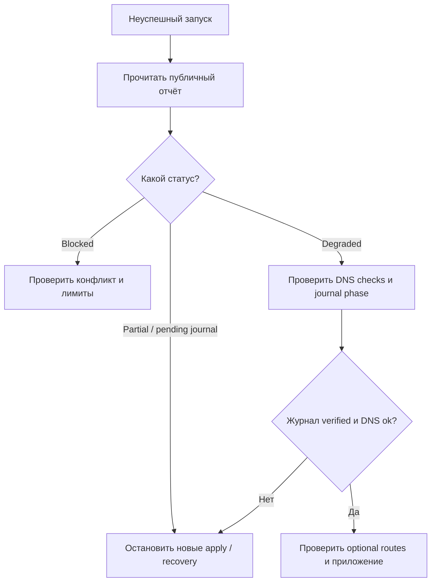

[SmartGate](../../../README.ru.md) / [Документация](../README.md) / Действия при сбое синхронизации

[English](../../en/operations/runbook.md) · [Русский](runbook.md)

# Действия при сбое синхронизации

В Summary сначала прочитайте таблицу **What happened**: код причины, объяснение и следующий шаг. [Справочник причин](diagnostics.md) поможет выбрать действие без расшифровки всех деталей. Если причина неизвестна или требуется конкретный план, используйте зашифрованный отчёт.

Для диагностики начните с `preview` или `doctor` без `--apply`. Параметры описаны в [CLI](cli.md), настройка workflow — в [Actions](actions.md). Не редактируйте ownership и journal вручную для обхода блокировки.


## На этой странице

- [Blocked](#blocked)
- [Pending journal или partial](#pending-journal-или-partial)
- [Degraded после применения](#degraded-после-применения)
- [Drift или неоднозначность при recovery](#drift-или-неоднозначность-при-recovery)
- [Прерванный rollback](#прерванный-rollback)
- [Локальный lock](#локальный-lock)
- [Команды восстановления](#команды-восстановления)
- [Проверка готовности и миграция](#проверка-готовности-и-миграция)
- [Доступность ниже 85%](#доступность-ниже-85)
- [Ошибка ключа или шифрования](#ошибка-ключа-или-шифрования)



## Blocked

При временном сетевом сбое текущего relay SmartGate автоматически выполняет [одну отложенную TLS-проверку](../architecture/health.md#повторная-проверка-временного-сбоя) в том же запуске. Восстановившийся адрес сохраняется; успешный sync с подтверждёнными DNS-ответами может завершиться зелёным без ручного перезапуска. Если сбой длится дольше проверки или общий бюджет проб исчерпан, результат остаётся ошибкой. Следующий запуск по расписанию заново проверит маршруты.

Массовую замену сверх `max_mutations` или `max_change_ratio` нельзя считать успешным deployment: она блокируется до применения. Не повышайте лимиты только ради зелёного статуса.

Проверьте причины в плане: чужой rewrite, ручное изменение owned записи, непройденная subtree compatibility, превышение лимитов или изменившаяся конфигурация.

Перестройте preview по актуальным DNS и state. Повышение лимитов должно быть осознанным решением оператора после просмотра конкретных изменений. Чужие записи не удаляются для автоматического устранения конфликта.

### Проверочный sync остановлен защитой

Сообщение `No-change acceptance blocked` означает, что свежий план содержит DNS-операции. В режиме `require_no_change=true` это ожидаемая блокировка до записей: посмотрите число операций в Summary, скачайте и расшифруйте подробный artifact, изучите сам план и решите, нужны ли изменения. Нулевой preview перед запуском не отменяет эту проверку.

Если защита обнаружила pending journal, выполните диагностику и отдельно разрешённое recovery. Проверочный режим сам его не запускает. При нулевом плане DNS остаётся прежним; служебные наблюдения в state могут обновляться.

## Pending journal или partial

Остановите новые apply. Сохранённое состояние и фактический профиль нужно сначала сопоставить через recovery. Повторное создание того же домена вручную может сделать атрибуцию неоднозначной.

Если прежний процесс ещё работает, дождитесь его завершения. Recovery другим runner по умолчанию ждёт окончания execution deadline. Досрочный takeover допускается только после проверки, что прежний процесс остановлен.

При недоступном state store не продолжайте DNS-операции и не используйте независимый новый ledger. Дождитесь восстановления хранилища, загрузите его актуальную revision и выполните recovery.

## Degraded после применения

> [!IMPORTANT]
> `degraded` описывает несколько ситуаций. Недоступный необязательный домен при `verified` и успешных DNS checks не равнозначен незавершённой операции. Проверьте journal phase и checks в отчёте перед recovery.

Если профильный DNS не подтверждён после API-записи:

API мог подтвердить записи, пока DNS-ответы не сошлись с ожидаемыми значениями. Состояние остаётся partial; обычный apply блокируется. Recovery повторит DNS-проверки и подтвердит журнал без дублирования уже выполненных операций.

Проверьте профильный DoH и точку наблюдения. Успешная проверка DNS не означает успешный прикладной доступ через relay.

## Drift или неоднозначность при recovery

Не удаляйте найденные записи автоматически. Сверьте record IDs и before/after с durable journal, затем определите, какие изменения были внесены оператором.

Копия after с другим ID и несколько matching domain/content записей требуют ручного разбора. Rollback также блокируется, если известный after изменён или удалён вручную. Запись после ещё не начатой операции не считается результатом контроллера, даже если domain/content совпадают с планом. Нельзя обходить это удалением всего профиля.

## Прерванный rollback

Запустите восстановление сохранённого inverse intent после окончания lease либо подтверждённой остановки предыдущего процесса. Если before уже восстановлен и его новый ID однозначно атрибутируется, повторное создание не требуется.

После восстановления проверьте итоговый ownership и профильные DNS-ответы. Кеши и открытые соединения клиента могут продолжать использовать прежний IP.

## Локальный lock

После аварии может остаться state lock. Удалять его можно только после проверки, что процесс, использующий этот файл, остановлен. Не удаляйте сам файл состояния и не создавайте параллельный ledger для того же профиля.


## Команды восстановления

```console
python -m smartgate recover --config config/smartgate.toml --report-dir .smartgate/reports
python -m smartgate recover --config config/smartgate.toml --apply --report-dir .smartgate/reports
python -m smartgate rollback --config config/smartgate.toml --run-id SAVED_JOURNAL_RUN_ID --apply --report-dir .smartgate/reports
```

Первый вызов только показывает сохранённую попытку. Для apply нужен `sync.enabled=true`. Замените `SAVED_JOURNAL_RUN_ID` на `journal_run_id` последнего отчёта; старые журналы вне текущего state автоматически не откатываются.

Другой runner ждёт окончания 20-минутного execution lease. Только после проверки, что предыдущий процесс остановлен, можно явно добавить `--previous-run-stopped` к recover/rollback с apply. Этот флаг нельзя использовать для параллельного восстановления работающего контроллера.

Если профиль обслуживается Actions, используйте тот же `config/smartgate.actions.toml` и GitBranchStateStore с DNS-переменными, `GITHUB_REPOSITORY`/`GITHUB_TOKEN`, ключом состояния и параметрами привязки encrypted report из [примера CLI](cli.md#первый-apply); локальное независимое state запрещено. В Actions выберите recover или rollback и `apply=true`, для rollback укажите сохранённый ID. Bootstrap при восстановлении не нужен.

## Проверка готовности и миграция

Перед включением расписания выполните [сценарии на тестовом устройстве](../getting-started/device-check.md). Текущий статус проверок приведён в [матрице приёмки](../project/acceptance.md). Для смены relay используйте [порядок миграции](migration.md) с preview и ручным apply.


### Доступность ниже 85%

Скачайте и [расшифруйте подробный artifact](privacy.md#чтение-подробного-отчёта), затем проверьте его availability: порог применяется к каждому включённому сервису отдельно, обязательные домены должны работать все. Неудачные IP-кандидаты сами по себе не снижают процент, если домен получил другой подтверждённый маршрут. При verified журнале и успешных DNS checks низкое покрытие требует проверки relay/набора доменов, а не повторного recovery. [Правила подсчёта](actions.md#порог-доступности-маршрутов).

## Ошибка ключа или шифрования

Не удаляйте state и не выполняйте повторный bootstrap. Остановите writers и проверьте Secret, repository/branch/instance binding, закрытый журнал и backup. При потере ответа миграции сначала установите точный текущий commit. При потере ключа восстановите прежний ключ из защищённой копии; новый ключ не прочитает старое состояние. [Приватность и восстановление](privacy.md).

---

[Все документы](../README.md) · [Главная](../../../README.ru.md) · [Настройка Actions](actions.md) · [Помощь при сбое](runbook.md)
