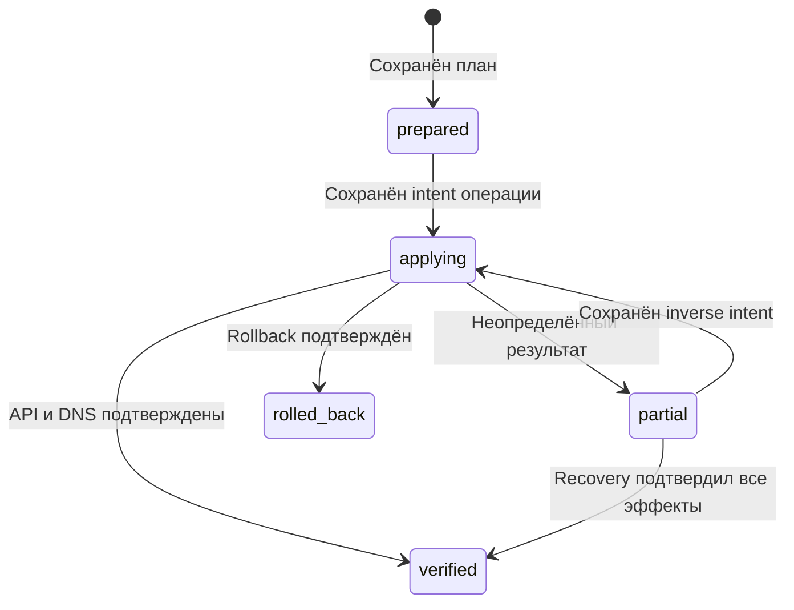

[SmartGate](../../../README.ru.md) / [Документация](../README.md) / Состояние и журнал операций

[English](../../en/operations/state.md) · [Русский](state.md)

# Состояние и журнал операций

StateStore хранит владение DNS-записями, выбранные маршруты, снимки источников, курсоры проверок и журнал операций. Состояние привязано к конкретному DNS-назначению. DNS credentials, GitHub token и ключ шифрования не входят в документ. Журнал описывает операции контроллера, а не посещения сайтов пользователем.

## На этой странице

- [Формат](#формат)
- [Локальное хранилище](#локальное-хранилище)
- [Хранилище GitHub](#хранилище-github)
- [Журнал](#журнал)
- [Использование контракта](#использование-контракта)
- [Полный журнал применения](#полный-журнал-применения)
- [Привязка к DNS-назначению](#привязка-к-dns-назначению)
- [Обновление старого состояния](#обновление-старого-состояния)
- [Шифрование Git-состояния](#шифрование-git-состояния)

## Формат

Текущий документ использует `schema_version = 2`; schema 1 читается для явно разрешённого перехода. Неизвестные поля, повторяющиеся JSON-ключи, несовместимая версия, другой профиль, неверные типы и timestamps без timezone блокируют загрузку. Максимальный размер JSON документа до шифрования — 1 MiB.

Ownership содержит record ID, домен, текущий IPv4, provider ID и время последней проверки. Selections сохраняют endpoint и digest политики маршрутизации. Кеш выбора сам по себе не подтверждает ownership.

Revision возвращается хранилищем: для файла это SHA-256 содержимого, для GitHub — commit SHA ветки состояния. В JSON revision записывается как null, чтобы не создавать зависимость хеша от самого себя.

## Локальное хранилище

LocalStateStore хранит незашифрованный JSON; файл и резервные копии должны оставаться вне Git с ограниченным доступом. Адаптер записывает временный файл в той же папке, сбрасывает буфер на диск и атомарно заменяет основной файл. На POSIX также синхронизируется каталог. Файловая блокировка исключает одновременный доступ через этот адаптер.

При сохранении фактическая revision сравнивается с expected revision. Несовпадение означает StateConflict. Ошибка записи блокирует дальнейшую работу; её нельзя считать успешным сохранением журнала.

После аварийного завершения может остаться файл `state.json.lock`. Он не удаляется автоматически по возрасту. Перед ручным удалением нужно убедиться, что использующий этот файл процесс остановлен.

## Хранилище GitHub

GitBranchStateStore использует отдельную ветку `smartgate-state` и файл `state/{instance_id}.json`. Чтение фиксируется на конкретном commit SHA. Сохранение создаёт blob, tree и commit с ожидаемым родителем, затем обновляет ref без force.

Перед обновлением повторно проверяется текущая ветка. Конкурентное изменение либо отказ сервера блокируют сохранение. Уникальная метка каждого commit intent не позволяет двум одинаковым сохранениям получить один и тот же коммит. Правила ref updates описаны в [GitHub REST API](https://docs.github.com/en/rest/git/refs).

Чтение отсутствующей ветки возвращает отсутствие состояния и не создаёт её. Bootstrap — отдельная явная операция: создаётся orphan-ветка только с данными состояния, без исходного кода. Сохранение другого профиля в существующую ветку сохраняет остальные файлы через base tree.

GitHub token передаётся только `api.github.com`; redirects и системные proxy-настройки отключены. На один экземпляр транспорта предусмотрено до 400 запросов и 20 минут. Неопределённый результат записи не повторяется автоматически: сначала нужно заново прочитать состояние.

Перед apply/recover/rollback контроллер проверяет запас запросов для всей партии: `13 × число операций + 35 + оставшийся резерв повторных чтений` (резерв изначально равен 12). Если оставшегося бюджета недостаточно, DNS-изменения не начинаются. Это отдельное ограничение от `max_mutations`; повышение лимита mutations не увеличивает лимит GitHub.

В пределах одного запуска адаптер кеширует идентичность автора и последние state/tree только по точному commit SHA. Текущий branch ref читается заново; кеш не разрешает сохранение поверх изменений другого writer. Новый runner начинает без этого кеша.

Если сразу после подтверждённого `save` GitHub возвращает точный предыдущий commit SHA, адаптер повторяет только чтение ссылки: максимум 4 попытки на одно чтение и 12 дополнительных запросов на экземпляр хранилища. Запросы ссылки имеют уникальный параметр и `Cache-Control: no-cache`. Эти дополнительные запросы резервируются при preflight в пределах общего лимита 400. Адаптер ждёт подтверждённую новую версию, а не подставляет её из кеша. Посторонняя версия, исчезнувшая ссылка, повреждённый ответ или исчерпание повторов не считаются успешным чтением ожидаемого состояния. Создание commit и обновление ссылки повторно не отправляются.

Автор и committer записей состояния задаются по аккаунту токена. Для installation token GitHub Actions используется владелец личного репозитория. GitHub noreply email связывает коммит с аккаунтом без публикации личной почты. Репозитории организаций требуют отдельной поддержки авторства.

Ограничения и защита ветки могут запретить запись; такая ошибка не разрешает продолжать DNS-операции. Actions cache и artifacts не используются как источник ownership.

## Журнал

`prepare_journal` сохраняет план, исходный снимок и pending intent. Исполнитель apply должен передать полный фактический DNS-снимок через `before_snapshot` и долговременно сохранить полученное состояние перед первой mutation. Без этого optional argument helper сохраняет только before-записи затронутых операций.

`record_operation` возвращает новое состояние с результатом операции; вызывающий код обязан сохранить его. Confirmed create/replace требует record ID и domain/content, совпадающих с intent. Confirmed delete не содержит новой записи.

| Фаза | Значение |
| --- | --- |
| prepared | Намерение подготовлено |
| applying | Получены промежуточные результаты |
| verified | Все операции подтверждены |
| partial | Остались неподтверждённые результаты; требуется восстановление |
| rolled_back | Все операции отмечены восстановленными |

Pending, unknown или failed запрещают verified. Новое намерение нельзя подготовить поверх незавершённого журнала. Helper-функции не выполняют DNS-операций и сами не сохраняют файл.

Применение операций, сопоставление неизвестных результатов и rollback реализованы в [reconcile](../architecture/reconcile.md). Журнал позволяет обнаружить незавершённый запуск; он не делает GitHub и DNS-провайдера единой транзакцией.

## Использование контракта

После `save(state, expected_revision)` вызывающий код получает новую revision. Перед следующим сохранением нужно обновить immutable state этой revision либо загрузить его заново. Нельзя использовать независимые локальный и GitHub ledger для одного действующего профиля.

Поведение GitHub адаптера проверено offline contract-тестами. Сохранение состояния и его чтение следующим GitHub runner подтверждены ручной интеграционной приёмкой; подробности — в [матрице приёмки](../project/acceptance.md).

## Полный журнал применения

Исполнитель reconcile дополняет журнал before ownership/selections, target selections, исходными desired/removals, safety policy и каталогом сервисов. Для rollback сохраняются его флаг и pending inverse intent, а execution run ID/deadline защищают от recovery активного процесса.

Добавленные поля журнала имеют явные совместимые defaults при чтении старых документов; неизвестные поля по-прежнему отклоняются. Старый журнал без достаточных safety/ownership metadata может быть прочитан, но автоматическое выполнение блокируется. Это не разрешает обход preconditions через ручное редактирование.

## Привязка к DNS-назначению

Схема состояния 2 сохраняет `target_id` и fingerprint типа провайдера, API origin, scope и DoH. То же назначение проходит через план, журнал, применение и восстановление. Сервер или профиль с тем же именем экземпляра не получает владение прежними записями. Git-состояние находится в `state/<instance_id>.json`; идентификатор допускает только безопасное короткое имя.

## Обновление старого состояния

`state-upgrade --config <config>` проверяет переход без записи. Добавление `--apply` обновляет только формат состояния, без создания, удаления или замены DNS-записей. Команда требует новой конфигурации текущего NextDNS-назначения, совпадения owned ID при API read-back и закрытого журнала. Незавершённый журнал сначала восстанавливается прежней конфигурацией.

В Git новый файл и удаление старого пути входят в один коммит с проверкой прежнего head. Предыдущий коммит сохраняет исходный ledger. Потерянный ответ ref update подтверждается чтением точного нового commit и обоих путей; mutation не повторяется. Другой writer блокирует переход.

Локальное хранилище обновляет явно выбранный файл под эксклюзивной блокировкой, сохраняет оригинал в соседний `.backup`, атомарно заменяет файл и читает его обратно. Backup и состояние должны оставаться вне Git. Смена DNS-провайдера требует нового пустого назначения и отдельной приёмки, а не обновления старого ledger.

## Шифрование Git-состояния

Live Git-хранилище сохраняет весь документ в AES-256-GCM envelope. JSON документа и reconcile-интерфейсы не меняются; свежий nonce выдаётся при каждом сохранении. AAD связывает данные с репозиторием, state branch и instance ID. Максимальный размер расшифрованного документа остаётся 1 MiB. Ошибка ключа, целостности, версии или привязки блокирует работу без fallback к пустому состоянию. Локальный файловый адаптер остаётся незашифрованным.

`state-encrypt` — отдельный переход уже привязанного plaintext schema 2, не `state-upgrade`. Он сохраняет ownership, ID плана и закрытого журнала, проверяет DNS API и точный commit после CAS. При неизвестном результате запись не повторяется. [Ключ, переход и ограничения публикации](privacy.md).

---

[Все документы](../README.md) · [Главная](../../../README.ru.md) · [Настройка Actions](actions.md) · [Помощь при сбое](runbook.md)

## Ручная смена ключа

`state-rotate` проверяет или перешифровывает один привязанный документ Git-состояния. Требуются выключенное автоприменение и временный Secret нового ключа. Перед CAS-записью создаётся зашифрованный backup; основной Secret заменяется вручную. [Полный порядок](key-rotation.md).
