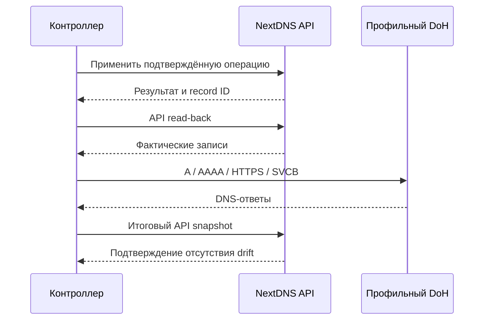

[SmartGate](../../../../README.ru.md) / [Документация](../../README.md) / NextDNS adapter и проверка DNS

[English](../../../en/providers/dns/nextdns.md) · [Русский](nextdns.md)

# NextDNS adapter и проверка DNS

NextDnsProvider управляет только rewrites выбранного профиля. Он не изменяет настройки устройства, профиль целиком или остальные параметры NextDNS.

## На этой странице

- [Операции API](#операции-api)
- [Ограничения транспорта](#ограничения-транспорта)
- [Профильный DoH](#профильный-doh)
- [Проверки совместимости](#проверки-совместимости)

## Операции API

List читает все страницы и возвращает record ID, домен и content. Посторонние IPv6 или hostname rewrites сохраняются в результате чтения: их нельзя потерять при вычислении изменений. Повреждённый ответ или повторяющийся ID блокируют работу.

Create отправляет name/content для публичного IPv4, проверяет возвращённый ID и тип A, затем подтверждает запись повторным list. Ответ без подтверждённого ID или несовпадающий read-back не считается успешной записью.

Delete сначала сравнивает фактическую запись с переданной precondition. При drift или отсутствии записи запрос DELETE не отправляется. После удаления проверяется отсутствие точного ID.

Replace использует проверенную стратегию DELETE → POST с сохранением домена. Она неатомарна: между запросами rewrite может отсутствовать. При неизвестном результате delete либо сбое создания после delete возвращается RecoveryRequired с before/after context. Mutation с неизвестным результатом автоматически не повторяется. Явный HTTP 429 может вызвать ограниченный повтор согласно Retry-After; это отдельный случай ответа rate limit.

Адаптер не принимает решение об ownership. Перед использованием create/delete/replace слой [reconcile](../../architecture/reconcile.md) проверяет владение, конфликты, лимиты и долговременно сохраняет журнал.

## Ограничения транспорта

API key передаётся только api.nextdns.io. Redirects и системные proxy-настройки отключены. Запросы разделяются интервалом минимум две секунды: до 30 запросов в минуту, максимум 400 вызовов и 20 минут на экземпляр транспорта.

GET повторяется ограниченно при сетевых сбоях и 5xx. HTTP 429 использует bounded Retry-After. HTTP 401/403 и errors envelope блокируют запрос. Потерянный ответ mutation, 5xx после mutation и неподтверждённый read-back требуют восстановления.

Сведения ошибки не содержат ключ, raw response body или HTTP headers. Context RecoveryRequired предназначен для локального журнала и восстановления; публичные отчёты должны учитывать чувствительность runtime IDs.

## Профильный DoH

Адаптер задаёт общий DnsVerifier адрес `https://dns.nextdns.io/{profile_id}` с DNS wire messages. API key в эти запросы не передаётся.

Для каждого желаемого домена проверяются:

| Тип | Ожидаемый ответ |
| --- | --- |
| A | Ровно выбранный IPv4 |
| AAAA | Пустой ответ |
| HTTPS | Пустой ответ |
| SVCB | Пустой ответ |

MVP консервативно отклоняет непустые альтернативные AAAA/HTTPS/SVCB ответы: их использование клиентом может обойти IPv4 rewrite. Допускающий их режим требует отдельного анализа совместимости.

Ответ должен соответствовать query ID, вопросу, owner name и типу записи. SERVFAIL, NXDOMAIN, truncated response, неожиданные CNAME и повреждённый wire payload не подтверждают маршрут. Только NOERROR и ожидаемые значения дают ok.

Verifier наблюдает распространение DNS до 60 секунд на вызов verify. Уже подтверждённые вопросы не повторяются, остальные проверяются с интервалом до пяти секунд. Поздний ответ не считается подтверждением; после deadline новые вопросы не отправляются. На экземпляр предусмотрены 800 DoH-запросов и 20 минут, на вызов — до 100 уникальных доменов.

Verify возвращает DnsCheck для каждого вопроса, включая фактические ответы, ожидание, время и ok. Вызвавший код обязан проверить все результаты; отсутствие исключения само по себе не означает успешную DNS-верификацию.

## Проверки совместимости

Базовый API/DNS contract проверен отдельным compatibility harness. Производственный адаптер дополнительно проходит opt-in test `tests/live/test_nextdns_production.py` на отдельном первоначально пустом профиле.

Production roundtrip проверяет create/list/delete/replace, parent/child precedence и A/AAAA/HTTPS/SVCB. Перед записью сохраняется intent, очистка удаляет только точные тестовые совпадения. Неоднозначные и посторонние записи сохраняются для ручного разбора. Runtime journal и evidence остаются вне Git; публичные fixtures обезличены.

Эти проверки подтверждают работу API и ответы тестового профиля. Они не подтверждают прикладной доступ через relay из сети клиента.

---

[Все документы](../../README.md) · [Главная](../../../../README.ru.md) · [Настройка Actions](../../operations/actions.md) · [Помощь при сбое](../../operations/runbook.md)

## Настройка подключения

Пример: [nextdns.example.toml](../../../../config/dns/nextdns.example.toml). Схема 2 использует общий блок DNS, способ авторизации `api_key` и переменные `SMARTGATE_DNS_API_KEY` и `SMARTGATE_DNS_PROFILE_ID`. Имя профиля нужно этому адаптеру; другим адаптерам оно не требуется. API origin фиксирован, адрес DoH выводится из того же профиля.

Для перехода со схемы 1 временно принимаются прежние имена переменных. Если старое и новое имя заданы одновременно с разными значениями, запуск блокируется без раскрытия значений. Пользовательские имена переменных разрешены в конфигурации и не получают автоматических alias.

Изменение примера не переводит существующее расписание или ownership state на новую схему: переход выполняется отдельно после проверки назначения и состояния.

## Первый запуск в GitHub

Создайте отдельный пустой профиль в NextDNS. API key доступен на [странице аккаунта](https://my.nextdns.io/account); profile ID возьмите из настроек выбранного профиля. В Environment `smartgate` сохраните key как `SMARTGATE_DNS_API_KEY`, profile ID как `SMARTGATE_DNS_PROFILE_ID`, а `SMARTGATE_APPLY_ENABLED` оставьте `false`.

Для новой установки используйте [настройку Actions](../../operations/actions.md): preview, явный пустой bootstrap, повторный sync и [проверку устройства](../../getting-started/device-check.md). Действующий старый ledger нельзя инициализировать заново — требуется проверенный state-upgrade. Лимит операций проверяется по свежему preview и не отменяется bootstrap.

## Квоты

NextDNS учитывает профильные DNS-запросы, включая проверки контроллера. По условиям, проверенным 07.10.2026, free plan предусматривал 300 000 запросов в месяц; при превышении NextDNS продолжал отвечать как обычный DNS без настроенных функций. Проверяйте использование и актуальные условия на [странице тарифов NextDNS](https://nextdns.io/pricing); работоспособность rewrites после исчерпания квоты здесь не предполагается.

API transport ограничен 30 запросами в минуту, 400 вызовами и 20 минутами на экземпляр транспорта; это ограничения SmartGate, а не заявленные квоты API NextDNS.
