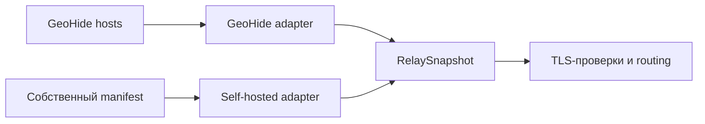

[SmartGate](../../../README.ru.md) / [Документация](../README.md) / Relay-провайдеры

[English](../../en/providers/relays.md) · [Русский](relays.md)

# Relay-провайдеры

GeoHide и selfhosted-провайдер возвращают одинаковый RelaySnapshot: набор явных пар домен/IP, время получения, digest источника и предупреждения. DNS-слой не зависит от формата источника. Адрес одного домена не переносится на другой автоматически.


## На этой странице

- [GeoHide](#geohide)
- [Selfhosted manifest](#selfhosted-manifest)
- [Качество snapshot](#качество-snapshot)
- [Проверенные источники](#проверенные-источники)



## GeoHide

Регион выбирает полный hosts-список непосредственно с [официального сайта GeoHide](https://geohide.ru/hosts):

| Регион | Источник |
| --- | --- |
| RU | [hosts RU](https://dns.geohide.ru:8443/static/formats/ru/hosts.txt) |
| EU | [hosts EU](https://dns.geohide.ru:8443/static/formats/eu/hosts.txt) |
| US | [hosts US](https://dns.geohide.ru:8443/static/formats/us/hosts.txt) |

Параметр `?v=…` из ссылки на сайте не фиксируется: SmartGate запрашивает текущий файл по постоянному адресу. Зеркало в стороннем GitHub-репозитории не используется. Полный список загружается, но для маршрутизации отбираются только домены включённых сервисов из `config/services.toml`. Остальные сайты автоматически не включаются.

Загрузка выполняется отдельным HTTP-клиентом без credentials DNS-провайдера. Redirect запрещён, TLS проверяется. Допустимы до трёх GET-попыток; connect/read timeout — 10 секунд. Размер распакованного источника ограничен 5 MiB, в том числе при отсутствии Content-Length.

Парсер поддерживает BOM, CRLF, комментарии и несколько aliases в строке. Уникальные пары сохраняются в детерминированном порядке. Публичные IPv6 остаются в snapshot для анализа; IPv4 MVP не публикует их как DesiredRewrite. Blocking, private, loopback, multicast и reserved IP не становятся relay-кандидатами.

Регион — метка списка источника, не доказанная страна выхода. Источники могут содержать адреса сторонних сервисов. Кандидаты считаются опубликованными источником endpoints, пока проверка TLS не подтвердила их пригодность.

## Selfhosted manifest

Локальный JSON содержит schema_version=1, provider_id и endpoints. Каждый endpoint явно задаёт публичный ip, port=443, transport=tls_sni_tcp и непустой список domains. Неизвестные поля, другой transport/port и несовпадающий provider_id отклоняются.

Пример структуры: [selfhosted.example.json](../../../config/selfhosted.example.json). Документационный IP в примере специально не пригоден для подключения: замените его публичным IP уже работающего relay. Один IP VPS без настроенного SNI/TLS relay не обеспечивает доступ к сервису.

В TOML добавьте провайдер:

```toml
[[relay.providers]]
id = "own"
type = "selfhosted"
manifest_path = "selfhosted.json"
```

Затем явно добавьте own в provider_order выбранного сервиса. Это меняет конфигурацию источника, а не контракт DNS-адаптера. Переключение выполняется через свежий preview и явный sync --apply с прежним ownership ledger; последовательность описана в [руководстве по миграции](../operations/migration.md).

## Качество snapshot

После получения источник фильтруется каталогом сервисов. Пустой результат, отсутствие обязательного домена, более 5% повреждённых строк hosts или падение выбранных пар более чем на 50% блокируют источник. Падение проверяется и по каждому сервису, чтобы рост другого сервиса не скрывал потерю маршрутов.

validate_snapshot сравнивает snapshot с предыдущим успешным снимком. Один запуск передаёт единый captured now в fetch и validate_snapshot. Снимок из предыдущего запуска сохраняет fetched_at; при возрасте до 24 часов он получает отметку «только сохранение существующих маршрутов». Старше 24 часов он отклоняется. Ошибка источника не является основанием удалять DNS-записи.

## Проверенные источники

09.10.2026 официальные RU/EU/US файлы успешно прочитаны существующим парсером: по 1020 доменов в каждом списке, соответственно 4034, 5036 и 4034 допустимые пары домен/IP. Эти числа отражают конкретную проверку и меняются вместе с источником. Получение hosts не меняет DNS-правила и само по себе не подтверждает доступность сервисов.

Минимальный curated fixture содержит только опубликованные RU-пары chatgpt.com. Контрактный тест строит эквивалентный selfhosted manifest и сравнивает domain/ip/port/transport без provenance провайдера.

По умолчанию в каталоге включён только ChatGPT с суффиксами chatgpt.com, openai.com, oaistatic.com и oaiusercontent.com. Остальные пресеты отключены и добавляются в отбор только после явного включения сервиса. Это не доказательство полноты auth/CDN-доменов для входа, загрузки файлов и всех клиентов. Родительские NextDNS rewrites распространяются на поддомены; согласие на такую область задаётся отдельно через allow_subtree_rewrites.

TLS/SNI checker реализован и проверен на двух кандидатах chatgpt.com; подробности в [проверках](../architecture/health.md). Ручная приёмка ChatGPT на Android и ноутбуке подтверждена в указанном в [проверках готовности](../project/acceptance.md) объёме. Работа собственного VPS relay пока подтверждена только контрактными fixtures, без live-приёмки. Успешное чтение hosts не подтверждает работоспособность ChatGPT.

---

[Все документы](../README.md) · [Главная](../../../README.ru.md) · [Настройка Actions](../operations/actions.md) · [Помощь при сбое](../operations/runbook.md)
